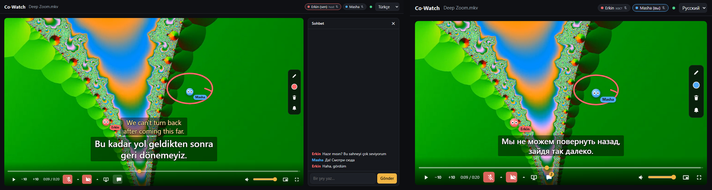

# Co-Watch

**English** · [Türkçe](README.tr.md) · [](https://github.com/erkinavcii/CoWatch/actions/workflows/tests.yml)

Watch the same film at the same time with friends far away, while everyone picks their own subtitle language. You can watch with Turkish + English subtitles while your friend sees Russian + English.



- **Your own subtitles:** each viewer picks a main and a second subtitle language; the film stays in sync for everyone.
- **Original quality, your own computer:** the host's file or torrent is streamed as it is when the browsers can play it (through Funnel, heavy files are converted to fit its bandwidth); no upload, no account, no server to rent.
- **One link for friends:** with Tailscale Funnel a friend needs only a browser.
- **Together:** voice, camera, screen sharing, chat, and pointers and a pen over the picture that land on the same spot of the film on every screen.
- **Stremio add-ons:** catalogs, sources and subtitles from add-ons you choose; only add-ons that host no content come built in.

Phase 1 (MVP): your own video file or a torrent → streamed in original quality (no re-encoding) → synced playback in everyone's browser + personal dual subtitles.

## How it works

```
local file ────────────────────────────────────┐
magnet ──> torrent helper (Node, webtorrent) ──┴──> ffmpeg (video copy, audio AAC stereo) ──> HLS
                                                                                               │
           Room + sync server (FastAPI, WebSocket) <──── play/pause/seek ──── browsers (hls.js)
```

- Everyone plays the same HLS stream in their own browser: no screen sharing, no quality loss.
- The server is the single source of truth: `playing`, `position`, `updatedAt`. A client that drifts more than 1 s seeks; between 0.1 and 1 s it catches up by changing playback speed by 5%.
- If a viewer's browser stops showing new frames while the film goes on (a black picture), that viewer alone seeks back to where the room is after 4 seconds; if it happens again within a minute, the stream is loaded afresh. A dark scene does not count: it is still 24 frames a second. Every few seconds each playing page also tells the server how bright its picture is; when one page is black while another is bright at the same film moment (a dark scene is dark for everyone), that page repairs itself the same way. Player errors, black pictures (with the player's numbers: buffer, frames, stream) and every wait for a slow viewer (who, where, how long) go to `data/playback.log` on the host's computer, with the name and the film time.
- If someone stalls (buffering), the room waits where they stopped, and everyone continues together once they have at least 3.5 s buffered. Someone who stalls again within two minutes gathers more the next time (10 s, then 20 s), so a slow link makes a few longer stops instead of many short ones; two calm minutes step it back down. A viewer stuck for more than 20 s no longer holds the room, and for the next 60 s their stalls do not stop it again (they catch up on their own).
- **Whose link keeps up:** each player measures how fast its film segments arrive and tells the others every 10 s. Hovering over a name at the top (or clicking it) shows e.g. "3.1 Mbps · film 4.7 Mbps"; the name is underlined in red when the link is below 1.2 times the film's bitrate. When the same viewer stalls three times in five minutes, the host (and trusted friends) get one notice saying how fast their link is and what the film needs, with "Lower the quality" (opens Settings → Picture quality) and, on Funnel, "Use Tailscale Serve"; not again for that viewer for ten minutes.
- Subtitles are never burned into the video: each browser draws its chosen subtitles against the film's clock (`film time = video.currentTime + streamStart`). Offset (±ms), size and height are personal.
- Subtitles are stored by the file's OpenSubtitles hash, so they are ready when the same film is opened again, whether from a torrent or a local file.
- Jumping to a part that is not prepared yet restarts ffmpeg from that point; the torrent downloads that part first.

## Requirements

| | Who | Note |
|---|---|---|
| Python 3.10+ | host | |
| Node.js 22+ | host | torrents only |
| ffmpeg + ffprobe | host | must be on PATH |
| Tailscale | host + viewers | the free personal plan is enough |
| A current browser | everyone | Chrome, Edge, Firefox, Safari |

Quick install on Windows (one command per line):

```powershell
winget install Python.Python.3.12
winget install OpenJS.NodeJS.LTS
winget install Gyan.FFmpeg
winget install Tailscale.Tailscale
```

## Setup

**Windows installer:** [`CoWatch-Setup-<version>.exe`](https://github.com/erkinavcii/CoWatch/releases/latest) (on the Releases page) installs Co-Watch for your user only (no administrator), with ffmpeg and Node inside, a Start menu shortcut and an uninstaller. Starting it puts an icon in the tray (next to the clock) and opens the room in the browser. The icon's menu opens the room, copies the friends' link, opens Settings or quits; quitting also stops the HTTPS link and the torrent helper. It starts with "Anyone with the link (Funnel)", so only Tailscale needs installing, and the Share card says what to do. Settings and the room key live in `%APPDATA%\CoWatch` and stay when you update or remove the app. Windows SmartScreen warns about an unsigned app the first time: "More info → Run anyway". The app tells the host when a new version is out: once a day it asks GitHub for the latest release, and the Share card and Settings show "Co-Watch 0.3.0 is out" with a link to its page (nothing updates by itself; `UPDATE_CHECK=0` turns the check off). Settings and the tray menu show the version you run.

To build the installer: `.\tools\build_windows.ps1` (needs the `.venv` below, Inno Setup 6 and the torrent helper's npm packages; it downloads ffmpeg and Node once). `python tray.py` runs the same tray app from the source code. The version is written once, in `server/version.py`; the script reads it from there.

Releases are built by GitHub Actions (`.github/workflows/release.yml`): change `VERSION` in `server/version.py`, commit, then push a matching tag (`git tag -a v0.3.0 -m "what changed"`, `git push origin v0.3.0`). The workflow builds the installer on Windows and puts it on that tag's release, making the release with the tag's message as its notes if it does not exist yet.

From the source code (for developers, and on other systems), Windows (PowerShell, in the project folder):

```powershell
py -m venv .venv
.\.venv\Scripts\python -m pip install -r requirements.txt
cd torrent-helper; npm.cmd install; cd ..
copy .env.example .env      # optional, for developers: settings normally go on the settings page
.\.venv\Scripts\python run.py
```

Python packages go into the project's `.venv` folder. `npm.cmd` instead of `npm` avoids PowerShell's script execution policy. If `py` is not available, use `python` in the first line. On macOS/Linux: `pip install -r requirements.txt`, `cd torrent-helper && npm install && cd ..`, `python3 run.py`.

`run.py` prints two links (its console messages are in Turkish):

```
Bu bilgisayardan:  http://localhost:8000/?k=KEY                  <- this computer
Arkadaşlar için:   https://pc.tail1234.ts.net/?k=KEY              <- send this one to your friend
```

The key in the link is the room's password; the browser stores it as a cookie on first visit. It lives in `data/access_key.txt`; "Make a new room key" under Settings → Advanced replaces it, and old links stop working.

**Share card and settings:** on the host computer the page shows a "Share" card: the friends' link with a Copy button and a QR code, and Tailscale's state with what to do about it (download it, open it, log in, allow Funnel, try again). Its "Settings" button sets how friends come in (Funnel, Serve or plain http), picture quality, film folders, who opens films, the OpenSubtitles account and, under Advanced, the port, the torrent upload limit, STUN servers and a new room key. They are kept in `data/settings.json`. Saving restarts the server for a few seconds (an open film closes; pages reconnect by themselves). A value set in `.env` wins and shows locked on the page. Only the host computer sees the card and the settings. With Funnel, "Measure the link" under the connection choice downloads 24 MB from the room's own public link, through Tailscale's relay like a friend would (the name is looked up with Cloudflare's public DNS, since on this computer it points inside the tailnet), and says e.g. "≈ 7.4 Mbps through Funnel: a film of up to ≈ 6.2 Mbps for 1 friend, ≈ 3.1 Mbps for 2 friends". With Serve each friend has their own path, so there is no test.

**HTTPS with Tailscale Serve:** when Tailscale is running, `run.py` starts `tailscale serve` and gives your friends an `https://….ts.net` link; browsers open the camera and microphone only on secure pages. Once, in the [Tailscale admin console](https://login.tailscale.com/admin/dns), turn on MagicDNS and HTTPS Certificates (if something is missing, `tailscale serve` prints a link to enable it). The computer's name ends up in public certificate logs, so rename it first if it contains personal details. Serve stops together with `run.py`. The server then listens only on this computer, so the old `http://100.x.y.z:8000` link no longer works. With "Plain http" under Settings (`TAILSCALE_SERVE=0` in `.env`), or without Tailscale, you get plain http links as before (and Windows asks for firewall permission for Python).

**For your friend:** they install Tailscale and you invite them to your tailnet from the Tailscale admin console (the free personal plan allows 6 users). Sharing only this computer is enough for the film, but then two friends cannot reach each other for camera and voice. Then they open the link, type their name and press "Join".

**Without Tailscale for your friend (Funnel):** with "Anyone with the link (Funnel)" under Settings (`TAILSCALE_FUNNEL=1` in `.env`), `run.py` starts `tailscale funnel` instead: the same `https://….ts.net` link, but open to the whole internet, so your friend needs only a browser. The first time, `tailscale funnel` prints a link to allow Funnel for this computer; the Share card shows it as an "Allow" button. The key in the link is then the room's only lock, so send it only to the people you watch with. Voice and camera then find their way through home routers with Cloudflare's free STUN server; on some networks (strict company or mobile networks) they may still not connect. The film goes through Tailscale's relay servers, which have a bandwidth limit Tailscale does not publish. In one measurement about 7–8 Mbps reached a viewer through Funnel while the home upload itself had about 30 Mbps, so files up to about 5–6 Mbps play comfortably. With picture quality on "Automatic" (the default), heavier files are therefore converted to 4.5 Mbps on Funnel (see "Upload speed"). Every friend coming over Funnel pulls their own copy through the same relay, so on "Automatic" the stream also gets its share of a 6 Mbps budget (`FUNNEL_BUDGET_KBPS`): 3 Mbps each for two friends, 2 Mbps for three, never below 1.5 Mbps; an H.264 file whose copies would add up to more than the budget is converted instead of sent as it is. The host on this computer does not count. The film opens with the number of friends in the room then. When more join while it plays, the stream is not restarted by itself (everyone's film would stop for a few seconds): the host and co-hosts get a notice ("3 friends are watching through Funnel now: the film fits better at 2.0 Mbps. Re-encode now?") with a button that restarts it where the room is. They are asked once for each new, higher number; when friends leave nothing is asked, and the next seek beyond the converted part (or the next film) gives the better picture back. The media card then says why the bitrate is lower (e.g. "4.0 Mbps → 2.0 Mbps · for 3 friends").

## Usage

1. **Open a film:** for your own file, press "Browse…" and pick it in the file dialog that opens on the host computer, or type its full path into "File path on this computer" and press "Open file" (for security, both only appear on the host computer). With a film folder set (Settings → Film folders, or `LIBRARY_DIRS` in `.env`), its videos are listed under "Film folder" with a search box; one click opens one. For a torrent, paste the magnet link and press "Add torrent"; if it holds several videos, pick one from the list. A torrent is not downloaded whole before it plays: only the chosen file, its beginning and end first (the container's header and index), then in playing order, so the film starts once the first few seconds are there. While a film opens, the stage shows each step with a bar and, for a torrent, its peers, speed and what has come so far; buttons that wait show a spinner. "Cancel" there stops an open that hangs (a torrent nobody shares can wait for peers for minutes), and opening another film replaces the one still opening; the film playing until then goes on either way. **Several sound tracks** (dubbed and original): the media card shows a "Sound" choice; it changes the sound for everyone, and the stream starts again from where the room is. **Disk space:** films opened from a torrent are downloaded to this computer and pile up; Settings → Storage shows how much they take and "Clean up" deletes all but the film playing. **Series:** when the film is one episode of a season torrent, a film folder or (for the host) a folder on this computer, the media card shows "Next episode: S01E05 World On Fire", and in the last minute a card over the picture offers it too, to whoever may open it. The order comes from the file names (`S01E05`, `1x05`, `Episode 5`, `E05`, an anime's `- 05`), else by name; samples are skipped. The next episode keeps the sound language chosen for the one before, and your subtitle languages pick its subtitles as usual. **Resume:** the server remembers where each film was left (`data/positions.json`, the last 200 films); a film opened again starts paused there, and everyone sees "Resumed at 42:10" with "Start from the beginning". Films watched to their last two minutes are forgotten.
2. **Browse:** the "Browse" card shows catalogs from [Stremio add-ons](https://github.com/Stremio/stremio-addon-sdk/blob/master/docs/protocol.md): posters, search, seasons and episodes, and the sources the add-ons know for a film or episode. "Open" plays a source for everyone. Two add-ons that host no content come built in: Cinemeta (catalogs and details) and Public Domain Movies (films out of copyright). The host can add other add-ons by their `…/manifest.json` address under "Add-ons"; they are kept only on that computer, in `data/addons.json`. "Import from Stremio" there adds the add-ons already installed in the Stremio desktop app on the same computer: it reads Stremio's add-on list from disk (Stremio need not be running) and adds the ones that answer; the Stremio account itself is not touched. For a film opened from an add-on, "Search the add-ons" under "Add subtitles" lists the subtitles those add-ons offer, matched by the film's id and file hash. Add-ons give no names, so several in one language are numbered in the add-on's order (#1 is usually the best match). Adding one makes it your main subtitle when you had none or one in the same language, so trying the next one after an out-of-step one is a single click; one already added offers "Make it main", and a deleted one can be added again. The list under "Subtitles for this film" marks your main and second one. Long lists stay short: sources sit in a box of their own with a search field (every word must match), an add-on picker and quality buttons (4K, 1080p, 720p, SD, read from the source's name and description), 15 at a time; add-on subtitles show your own languages first, 8 at a time. Scrolled down to them, the film follows in a small box in the corner (a click scrolls back, ✕ hides it until you scroll up again). In Chrome and Edge, the window button next to fullscreen puts the film in its own small window that stays on top of every app and monitor, subtitles, pointers and drawings included.
3. **Add subtitles:** under "Add subtitles", search OpenSubtitles by language codes (e.g. `tr,en,ru`) or upload an `.srt/.ass/.vtt` file. Old encodings such as Turkish `cp1254` and Russian `cp1251` are fixed automatically. **Nothing in your language?** "Translate it with AI" below the searches translates a subtitle in the room (the English one first) with a language model: choose the provider under Settings → Automatic subtitle translation. AI models understand the context: DeepSeek, Claude, Gemini, Kimi, OpenAI, OpenRouter, or a model on this computer with Ollama or LM Studio (free, the text stays on your computer); anything else that speaks the OpenAI or Anthropic protocol under "Custom". Translation services go line by line, without the film's context, and most have a free allowance: Microsoft Translator (about 2 million characters a month on Azure's free plan, about 30–40 films), DeepL (500,000 a month, very good), Google Cloud Translation (500,000 a month, needs a billing account), LibreTranslate (open source, on this computer, no account) and MyMemory (no account, 5,000 characters a day, 50,000 with an e-mail address: for short tries). The list says which need an account. Google Translate's unofficial free address is left out on purpose: using it breaks Google's terms. "List models" asks the provider which models it has, "Try" translates two lines. Only numbered lines of text go out, no timestamps; a brief of the film comes first (characters, who speaks formally to whom), then the lines in chunks. It takes a minute or two for a film, everyone sees the progress, and the translation joins everyone's list and is kept, so the same film is never paid for twice. A film costs from about two cents to about a dollar depending on the model. By default only the host and trusted friends can start one, since the host pays. The plan behind it: [docs/altyazi-ceviri-plani.md](docs/altyazi-ceviri-plani.md) (in Turkish). **Subtitles inside the file** (an MKV's text tracks, e.g. anime "Multi-Subs" releases) join the list by themselves, marked "in the file", in sync with the file: at once for a file on this computer, once the download has finished for a torrent (they are spread over the whole file). Picture subtitles (Blu-ray PGS) cannot be turned into text, and an add-on's web stream is not read again for them.
4. **Pick your own subtitles:** uploaded subtitles go to everyone's list, but each viewer picks what shows on their own screen. The "main subtitle" is the large white line at the bottom. The "second subtitle" is optional and shows as a smaller yellow line above it, for watching in two languages at once (you TR + EN, your friend RU + EN). Text size and height are personal too, and so is the timing offset, which each subtitle keeps on its own: a Russian subtitle made for another release can be 2 s early while the Turkish one is 1 s late, and the offset you give a subtitle is still there the next time you pick it. Preferred languages are remembered, so in a new film a subtitle in that language is selected automatically.
5. **Pointers and pokes:** everyone's pointer shows over the video as a ball with eyes, their name and their colour (it fades after 4 s without movement). Clicking the video makes your ball blink, sends out a ring and plays a short sound for everyone, pitched by colour. The bell on the right turns the sound off. The same click plays or pauses the film for everyone; a double click goes fullscreen without pausing; when someone pauses, the others see who did at the top of the picture. On the join screen you pick your colour and an animal (cat, bear, bunny, fox, panda, mouse, dog, or the plain ball): your ball, and your tile while your camera is off, wear its ears and snout, and close their eyes into happy arcs while you talk. The colour button changes both later.
6. **Drawing:** draw on the video for everyone with the pen on the right (`d`); strokes appear live and land on the same spot of the film whatever the screen size. While the film plays, strokes fade after a few seconds; while it is paused, they stay. The eraser under the pen (`e`) rubs out, for everyone, the part of anyone's drawing it passes over; the choice beside it switches to taking away whole lines it touches. The colour button changes your colour (ball and pen), the bin clears everyone's drawings.
7. **Voice:** the microphone button next to the time (`Ctrl+D`) turns your microphone on and off; it starts off, and red means off. The sound goes straight to the others, not through the server. Off really releases the microphone (the red dot on the tab goes away), and a crossed-out microphone shows next to your name. Whoever talks glows in their colour, at the top and on their ball, and the film gets quieter for a moment. The arrow next to the button picks the microphone and turns that off. Click someone's name at the top to set how loud you hear them. Use headphones until echo has been tested with speakers. Friends need the HTTPS link (see Setup); browsers do not open the microphone over plain http.
8. **Camera:** the camera button (`Ctrl+E`) works the same way; off turns the camera light off. While anyone's camera is on, small tiles appear over the top right of the video, without shrinking the film: the picture of those with their camera on, the coloured ball of the others, your own picture mirrored at the bottom. They stay in fullscreen; on a phone they line up along the top. The arrow next to the button picks the camera and hides your own tile or all tiles. Clicking a camera that is on shows it large over the picture (click again or `Esc` to make it small); clicking someone without a camera, or right-clicking any tile, sets that person's volume. With many tiles on a short picture they get smaller instead of being cut off. Drag the tiles to any corner; the small button on their corner makes them smaller. A camera sends at most about 0.5 Mbps to each viewer.
9. **Before joining:** the join screen has the same microphone and camera buttons with a preview and a level meter, as in Meet; whatever is on there is on when you join. Both start off.
10. **Trusting a friend:** the host can click a friend's name at the top and press "Let them open the film folder". The friend then sees the "Film folder" list too and can open films from it for everyone, but cannot type paths, reach other files on the disk or change the add-ons. A small "trusted" label shows next to their name; "Take it back" in the same place ends it. The trust belongs to the friend's browser, so it survives a dropped connection, and lasts until the app restarts. Anyone with the link can open torrents and add-on sources and close the film; with "Only you and the friends you trust" under Settings (`MEDIA_CONTROL=trusted` in `.env`), only the host and trusted friends can. The same box has "Remove from the room": for a page left open somewhere, or an entry from a phone that never finished (those show as "?"). The page removed goes back to the join screen and does not reconnect by itself; joining there again brings it back.
11. **Screen sharing:** the screen button next to the camera shares a window, a browser tab or the whole screen, with its sound when the browser offers it (Chrome and Edge on Windows). The shared screen covers the film for everyone and the film pauses until the share ends; pointers and the pen work on it too. One screen at a time. The host and trusted friends share at once; anyone else first picks what to share, then waits while the host (or a trusted friend) sees "… wants to share their screen" with "Allow" and "Decline". Nothing is sent before that, and without an answer the request lapses after 30 seconds. If someone is already sharing, allowing a new share ends theirs. The host can stop anyone's share from their name at the top. The picture goes straight to the others, like the camera (not through Funnel). The arrow next to the screen button sets the sharer's quality: Auto (up to 4 Mbps per viewer; when the link or the processor falls short, motion stays smooth and the picture gets blurry), High (up to 10 Mbps; the picture stays sharp and frames drop instead) or Low (at most 720p and 1.5 Mbps). The same menu shows the live picture size, frame rate and bitrate, and whether the link or the processor is holding it back; DRM-protected sites (Netflix and the like) show black in a share.
12. **Chat:** on a wide screen the chat is a column right of the film, as tall as the film; on a phone held upright it is a box under the film. ✕ closes it and the speech bubble in the controls (`c`) brings it back. In fullscreen, in the small window and on screens in between (a tablet, a phone on its side) the same chat opens over the bottom left of the video instead, with the bubble or `c`; there `Esc` closes it. Enter sends. While it is closed, new messages show in the same corner for a few seconds and a number on the button counts them; while the controls are hidden a small dot stays in the bottom left corner, and the tab's title shows the count when you are in another tab. The last 100 messages wait for those who join later; they live only in the host computer's memory and are gone when the app restarts. At most 500 characters per message, and five in a row before a short wait. Web addresses (http and https) become links that open in a new tab; a long one is shortened in the middle, and the whole address shows on hover and is what gets copied.
13. **On a phone:** the header stays one line (the names scroll sideways), notices sit at the bottom, and the drawing tools hide with the controls while the film plays. On its side, the film takes the screen's height. On the iPhone, where a web page cannot go fullscreen, the fullscreen button makes the film fill the window. While the room plays, the screen does not dim or lock (on the HTTPS link). The lock screen, the notification and headset buttons show the film's name and play, pause and skip 10 s for the whole room, like the buttons on the page.
14. **Connection drops:** the page reconnects to the room by itself, also when the link only goes quiet for a while (no answer from the server for 25 s), and comes back to where the film is; voice and camera connections that drop (Wi-Fi change, laptop sleep) are rebuilt by themselves.
15. **Shortcuts:** space play/pause, ← → 10 s, `f` fullscreen, `m` mute the film, `d` pen, `e` eraser, `c` chat, `Ctrl+D` microphone, `Ctrl+E` camera, `Esc` pen, chat or a large camera off. Clicking the video plays or pauses. On touch screens, tapping the video only shows the controls; pausing for everyone takes the button. A quick double tap on the small picture goes fullscreen, wherever it lands. In fullscreen a double tap on the left or right quarter goes back or on 10 s for the room, and more taps right after add up (20, 30 s) into one seek; a double tap in the middle comes back to the small picture.

The interface is available in Turkish, English and Russian.

## Quick test

On one computer, with two browser windows:

1. In the project folder, generate a test video. It runs for 2 minutes, shows the current second as a big number, and like torrent files it has H.264 video and AC3 5.1 audio:
   ```powershell
   ffmpeg -f lavfi -i testsrc=size=1280x720:rate=24 -f lavfi -i "sine=frequency=440" -t 120 -c:v libx264 -g 48 -pix_fmt yuv420p -af volume=0.1 -c:a ac3 -ac 6 samples\test-video.mkv
   ```
2. Start with `.\.venv\Scripts\python run.py`, open the "Bu bilgisayardan" (this computer) link, type your name and press Join.
3. Press "Browse…" and pick `samples\test-video.mkv`, or paste its full path into "File path on this computer". In File Explorer you can right-click the file and choose "Copy as path"; the quotes are fine.
4. Open the same link in a private window and join under another name.
5. Under "Add subtitles", upload `samples\test.tr.srt` with language `tr` in the first window and `samples\test.ru.srt` with `ru` in the second. Both use old encodings (cp1254 and cp1251); Turkish and Russian letters should show correctly.
6. Press play. The second in the subtitle should match the big number on screen, and both windows should stay on the same frame. Try seeking, pausing and the ±0.5 offset.
7. Move the mouse over the video in one window: the other window shows a ball with your name and colour. Click: the ball blinks and both windows play a sound. Press `d` and draw; the stroke appears at the same spot in the other window.

For a real torrent, use Sintel, the Blender Foundation's openly licensed (CC BY) film:

```
magnet:?xt=urn:btih:08ada5a7a6183aae1e09d831df6748d566095a10&dn=Sintel&tr=udp%3A%2F%2Fexplodie.org%3A6969&tr=udp%3A%2F%2Ftracker.coppersurfer.tk%3A6969&tr=udp%3A%2F%2Ftracker.empire-js.us%3A1337&tr=udp%3A%2F%2Ftracker.leechers-paradise.org%3A6969&tr=udp%3A%2F%2Ftracker.opentrackr.org%3A1337&tr=wss%3A%2F%2Ftracker.btorrent.xyz&tr=wss%3A%2F%2Ftracker.fastcast.nz&tr=wss%3A%2F%2Ftracker.openwebtorrent.com&ws=https%3A%2F%2Fwebtorrent.io%2Ftorrents%2F&xs=https%3A%2F%2Fwebtorrent.io%2Ftorrents%2Fsintel.torrent
```

## Upload speed (per viewer)

Required upload ≈ the file's bitrate × 1.3. If you don't know the bitrate: for a 2-hour film, file size in GB × 1.1 ≈ Mbps.

| Source | Bitrate | Comfortable upload |
|---|---|---|
| Compact 1080p (2-hour film, 2-3 GB) | 2.5-3.5 Mbps | 5 Mbps |
| 1080p WEB-DL (4-7 GB) | 5-8 Mbps | 8-10 Mbps |
| 1080p BluRay encode (8-12 GB) | 9-14 Mbps | 15+ Mbps or convert |
| Phone recording (1080p) | ~15-20 Mbps | convert |
| Converted stream (`TRANSCODE_KBPS=5000`) | 5 Mbps | 8 Mbps |

Multiply by two for two viewers. With a slow upload, choose "Limit by hand" under Settings → Picture quality (e.g. 6 Mbps; `MAX_COPY_KBPS=6000` in `.env`): heavier files are then converted automatically. Videos that are not H.264 (HEVC/x265, 10-bit) are always converted. A converted stream gets at most twice the source's video bitrate (at least 1.5 Mbps), never more than `TRANSCODE_KBPS`: a 1.1 Mbps x265 episode becomes 2.2 Mbps, not 4.5; the media card shows both (e.g. "1.2 Mbps → 2.2 Mbps"). Converting uses the graphics card when one works (NVIDIA, Intel or AMD; tried for a moment at start, the CPU otherwise); the media card says which. In one measurement NVENC used a third of the CPU time of `libx264` and took half as long. `VIDEO_ENCODER` names one by hand.

The graphics card also decodes the source when it can (NVIDIA's decoder with an NVIDIA card, Windows' D3D11 decoder otherwise, VideoToolbox on a Mac; Linux decodes on the CPU). This matters most for 4K HEVC 10-bit films: in one measurement the CPU time for 20 s of 4K HEVC went from 30 s to 6.7 s. HDR films (HDR10, HLG, Dolby Vision) are converted to normal colours, otherwise they look grey and washed out on an ordinary screen and in the browser: on the graphics card with libplacebo (Vulkan; it also reads Dolby Vision), or on the CPU with zscale when there is no Vulkan card (about 2–3 CPU cores busy for a 1080p picture). With the card doing all of it, a 4K Dolby Vision film was converted at 4× real time using about a fifth of one CPU core. Everything is tried once at start; if the card fails on a real film, that film falls back to the CPU by itself. The media card shows "HDR → normal colours". `HW_DECODE` and `HDR_TONEMAP` turn these off or pick one by hand.

## Settings (.env)

Most of these are on the settings page. `.env` is for developers and for the rest; a variable set there wins over the page.

| Variable | Default | Description |
|---|---|---|
| `PORT` | 8000 | Web server port |
| `TAILSCALE_SERVE` | 1 | HTTPS link through Tailscale Serve when Tailscale is running, 0 = plain http links |
| `TAILSCALE_FUNNEL` | 0 | 1 = the HTTPS link through Tailscale Funnel, open to the internet: friends need no Tailscale |
| `LIBRARY_DIRS` | – | Film folders, separated by `;` (e.g. `D:\Films;E:\Series`): their videos are listed under "Film folder" for the host and trusted friends |
| `MEDIA_CONTROL` | everyone | `trusted` = only the host and trusted friends open and close films |
| `ADDONS_BUILTIN` | 1 | 0 = without the built-in add-ons (Cinemeta, Public Domain Movies), only the ones added by hand |
| `ADDONS_STREMIO` | 0 | 1 = at start, while no add-on has been added by hand, import the ones installed in Stremio on this computer |
| `AI_PROVIDER` | deepseek | Subtitle translation: `deepseek`, `claude`, `gemini`, `kimi`, `openai`, `openrouter`, `ollama`, `lmstudio`, `custom`, or a service: `deepl`, `microsoft`, `google`, `libretranslate`, `mymemory` |
| `AI_API_KEY` | | The provider's key (not needed for Ollama, LM Studio or LibreTranslate on this computer; an optional e-mail address for MyMemory); translation stays off without one |
| `AI_MODEL` | the provider's | E.g. `deepseek-flash`, `claude-opus-5-5`; for Microsoft, the Azure resource's region |
| `AI_BASE_URL`, `AI_PROTOCOL` | the provider's | For `custom`: the address and the protocol (`openai`, `anthropic` or one of the services) |
| `AI_TRANSLATE` | trusted | `everyone` = anyone in the room can start a translation |
| `STREMIO_DATA_DIR` | – | Where Stremio keeps its data, if not in the usual place (its `Local Storage\leveldb` folder or the folder around it) |
| `ICE_SERVERS` | – | Comma-separated `stun:` addresses for voice and camera; empty = only the viewers' own addresses (through Tailscale), or Cloudflare's STUN with Funnel |
| `TORRENT_UPLOAD_LIMIT` | 64 | Torrent upload limit (KB/s), 0 = unlimited |
| `MAX_COPY_KBPS` | 0 (5500 on Funnel) | H.264 files above this are converted, 0 = always original |
| `TRANSCODE_KBPS` | 5000 (4500 on Funnel) | Target bitrate of a converted stream (lower for a light source: twice its video, at least 1500) |
| `FUNNEL_BUDGET_KBPS` | 6000 on Funnel with "Automatic" quality, else 0 | Funnel only: the relay's total for all friends; a stream gets this split by their number (at least 1500), 0 = no split |
| `VIDEO_ENCODER` | auto | Encoder used for conversion: `auto` = the graphics card's if one works (`h264_nvenc`, `h264_qsv`, `h264_amf`), else `libx264` |
| `HW_DECODE` | auto | Decoding the source when converting: `auto` = on the graphics card if it works (`cuda`, `d3d11va`, `videotoolbox`), `off` = on the CPU, or an ffmpeg `-hwaccel` name |
| `HDR_TONEMAP` | auto | HDR films to normal colours: `auto` = `libplacebo` (graphics card) if it works, else `zscale` (CPU); `off` sends them unconverted |
| `MAX_HEIGHT` | 1080 | Maximum height when converting |
| `AUDIO_FILTER` | dynaudnorm | Evens out loud and quiet parts; leave empty to turn off |
| `OPENSUBTITLES_API_KEY` | – | Get one at [opensubtitles.com/consumers](https://www.opensubtitles.com/consumers) |
| `OPENSUBTITLES_USERNAME` / `_PASSWORD` | – | A free account allows about 20 subtitle downloads a day |

Once ffmpeg is more than 10 minutes ahead of playback, the torrent download slows down by itself, so it does not compete with the stream going to your friend on the same connection.

## Known limitations

- One room, one film. The room is protected by the link key.
- A Dolby Vision-only film (profile 5, with no HDR10 base) gets the right colours only with libplacebo (a Vulkan graphics card); on the CPU it is sent unconverted. Prefer an HDR10 release then.
- On iPhone, subtitles do not show in fullscreen (Safari can only make the video itself fullscreen); watch in landscape without fullscreen.
- DRM platforms (Netflix etc.) are not supported in this mode; a browser extension for them is on the roadmap.
- Downloaded torrents stay in `data/torrents` until "Clean up" under Settings → Storage.

## Legal note

Co-Watch does not provide, host or distribute any content. It is made for your own files or content you have the right to watch and share. Torrent support is for the protocol itself; using torrents for copyrighted content makes your IP address visible in the swarm, and you upload while you watch. Co-Watch speaks the Stremio add-on protocol; the only add-ons it ships with host no content (Cinemeta for catalogs and details, Public Domain Movies for films out of copyright). Which other add-ons you add is your own choice and responsibility. Users are responsible for how they use it.

## Development

```bash
pip install -r requirements-dev.txt
python -m pytest                      # media tests run too when ffmpeg is installed
python -m playwright install chromium # once, for the browser tests
python tests/e2e/two_viewers.py       # sync, subtitles, pointers, pokes, pen, chat; --headed to watch
python tests/e2e/voice_camera.py      # voice and camera
python tests/e2e/film_file.py         # subtitles and sound tracks inside a file, storage
python tests/e2e/slow_link.py         # a viewer with a slow link (about six minutes)
python tests/e2e/next_episode.py      # the next episode and resuming
```

Each browser test starts its own server and test video and opens Chromium windows. `two_viewers.py` checks sync, each viewer's own subtitles, that a pointer lands on the same spot of a letterboxed picture on another screen size, poke sounds, the lock screen buttons (Media Session) and keeping the screen on, the pen and clearing, the chat and its links, and a phone (the chat under the film, the drawing toolbar in a row over the short picture, the stage filling the window where fullscreen is missing). GitHub Actions runs `pytest` on Windows and Linux for every push. `voice_camera.py` joins as a friend coming through Tailscale Serve and checks voice, the camera tiles, a third viewer joining from the preview, and connections rebuilding themselves (with Chromium's fake camera, and synthesised speech as the microphone). `film_file.py` opens a video with two sound tracks and two subtitles inside, and checks that the subtitles join both windows' lists, that switching the sound reaches both, and the storage section of the settings. `slow_link.py` throttles one viewer's page below the bitrate of a 5 Mbps film and counts how often the room stops, checks that a viewer the room went on without does not stop it again within a minute, and that no picture goes black. `next_episode.py` opens the first of two episodes in a folder, moves to the second for both windows from the film card and from the card near the end, and opens the first again to check it resumes where it was left.

In the browser console, `cowatchDebug()` shows the sync values (film time, expected position, drift).

Layout: `server/` (FastAPI: room, sync, media, subtitles, pointers and drawing, voice and camera signalling, add-ons), `torrent-helper/` (Node: magnet → HTTP stream), `web/` (client; hls.js and the QR code generator live in `web/vendor`).

## Next phases

2. Subtitle automation: language-preference fallback chain, alignment with alass, two-pass LLM translation.
3. Joining with just a link (DataChannel + TURN), automatic conversion when the bitrate does not fit.
4. Voice and camera are in; to try with real devices: echo with speakers, phones, two computers over Tailscale.
5. Two-sided torrent sync and an extension for DRM platforms.

## License

[GNU AGPL v3.0](LICENSE) or later. In short: you can use, modify and share it; if you offer a modified version to others over a network, you have to share its source code with them too. That is why the app's join screen links to the source code.

`web/vendor/hls.light.min.js`: [hls.js](https://github.com/video-dev/hls.js), Apache-2.0 (`web/vendor/hls.js.LICENSE`).
`web/vendor/qrcode.js`: [qrcode-generator](https://github.com/kazuhikoarase/qrcode-generator), MIT (`web/vendor/qrcode.js.LICENSE`).
