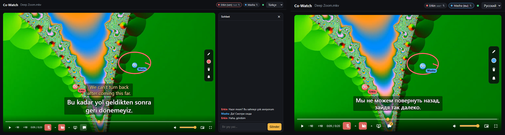

# Co-Watch

[English](README.md) · **Türkçe** · [](https://github.com/erkinavcii/CoWatch/actions/workflows/tests.yml)

Uzaktaki arkadaşlarınla aynı filmi aynı anda izle; herkes kendi altyazı dilini seçsin. Sen Türkçe + İngilizce görürken karşı taraf Rusça + İngilizce görebilir.



- **Herkese kendi altyazısı:** her izleyici bir ana ve bir ikinci altyazı dili seçer; film herkeste senkron kalır.
- **Orijinal kalite, kendi bilgisayarın:** host'un dosyası ya da torrent'i, tarayıcılar oynatabiliyorsa olduğu gibi akar (Funnel üzerinden ağır dosyalar onun bant genişliğine göre dönüştürülür); yükleme yok, hesap yok, kiralık sunucu yok.
- **Arkadaşa tek link:** Tailscale Funnel'la arkadaşın sadece tarayıcı açar.
- **Birlikte:** ses, kamera, ekran paylaşımı, sohbet; videonun üstünde her ekranda filmin aynı yerine düşen imleçler ve kalem.
- **Stremio eklentileri:** seçtiğin eklentilerden katalog, kaynak ve altyazı; hazır gelenler sadece içerik barındırmayan eklentiler.

Faz 1 (MVP): kendi video dosyan ya da bir torrent → orijinal kalitede akış (yeniden encode yok) → herkesin tarayıcısında senkron oynatma + kişiye özel çift altyazı.

## Nasıl çalışıyor

```
yerel dosya ───────────────────────────────────────┐
magnet ──> torrent yardımcısı (Node, webtorrent) ──┴──> ffmpeg (video kopya, ses AAC stereo) ──> HLS
                                                                                                  │
           Oda + senkron sunucusu (FastAPI, WebSocket) <──── play/pause/seek ──── tarayıcılar (hls.js)
```

- Herkes aynı HLS akışını kendi tarayıcısında oynatır; ekran paylaşımı yok, kalite kaybı yok.
- Sunucu tek doğru kaynaktır: `playing`, `position`, `updatedAt`. İstemci farkı 1 sn'yi aşarsa seek yapar, 0,1–1 sn arasında hızı %5 oynatarak yakalar.
- Film ilerlerken bir izleyicinin tarayıcısı yeni kare göstermeyi bırakırsa (siyah ekran), 4 saniye sonra sadece o izleyici odanın olduğu yere sarar; bir dakika içinde yine olursa akış baştan yüklenir. Karanlık bir sahne sayılmaz, o da saniyede 24 kare. Oynayan her sayfa birkaç saniyede bir resminin ne kadar parlak olduğunu da sunucuya söyler; aynı film anında bir sayfa siyahken bir başkası aydınlıksa (karanlık sahne herkeste karanlıktır) o sayfa kendini aynı yolla onarır. Oynatıcı hataları, siyah resimler (oynatıcının sayılarıyla: tampon, kare, akış) ve yavaş bir izleyici için her bekleme (kim, nerede, ne kadar) adı ve filmin zamanıyla host'un bilgisayarındaki `data/playback.log`'a yazılır.
- Biri takılırsa (buffer) oda onun durduğu yerde bekler, en az 3,5 sn'lik tampon oluşunca herkes birlikte devam eder. İki dakika içinde yine takılan izleyici bir sonrakinde daha çok biriktirir (10 sn, sonra 20 sn); yavaş bir bağlantı böylece çok sayıda kısa duruş yerine az sayıda uzun duruş yapar, iki sakin dakika onu bir basamak indirir. 20 sn'den uzun takılan izleyici odayı tutamaz ve sonraki 60 sn takılması odayı yeniden durdurmaz (kendisi yetişir).
- **Kimin bağlantısı yetiyor:** her oynatıcı film parçalarının ne hızla geldiğini ölçer ve 10 sn'de bir ötekilere söyler. Üstteki bir ismin üstüne gelince (ya da tıklayınca) örneğin "3,1 Mbps · film 4,7 Mbps" görünür; bağlantı filmin bit hızının 1,2 katından düşükse isim kırmızı çizilir. Aynı izleyici beş dakikada üç kez takılınca host (ve yetkili arkadaşlar) bir bildirim alır: bağlantısının hızı ve filmin istediği, "Kaliteyi düşür" (Ayarlar → Görüntü kalitesi'ni açar) ve Funnel'daysa "Tailscale Serve'e geç" düğmeleriyle; o izleyici için on dakika boyunca yenisi gelmez.
- Altyazılar videoya gömülmez: her tarayıcı seçtiği altyazıyı filmin saniyesine göre kendisi çizer (`film zamanı = video.currentTime + streamStart`). Kaydırma (±ms), boyut ve yükseklik kişiye özeldir.
- Altyazılar dosyanın OpenSubtitles hash'ine göre saklanır; aynı film tekrar açılınca (torrent ya da yerel dosya fark etmez) hazır gelir.
- Henüz hazırlanmamış bir yere atlanırsa ffmpeg o noktadan yeniden başlatılır; torrent o kısmı öncelikli indirir.

## Gereksinimler

| | Kimde | Not |
|---|---|---|
| Python 3.10+ | host | |
| Node.js 22+ | host | sadece torrent için |
| ffmpeg + ffprobe | host | PATH'te olmalı |
| Tailscale | host + izleyiciler | ücretsiz kişisel plan yeter |
| Güncel tarayıcı | herkes | Chrome, Edge, Firefox, Safari |

Windows'ta hızlı kurulum (her satır ayrı komut):

```powershell
winget install Python.Python.3.12
winget install OpenJS.NodeJS.LTS
winget install Gyan.FFmpeg
winget install Tailscale.Tailscale
```

## Kurulum

**Windows kurulum dosyası:** [`CoWatch-Setup-<sürüm>.exe`](https://github.com/erkinavcii/CoWatch/releases/latest) (Releases sayfasında) Co-Watch'u sadece senin kullanıcın için kurar (yönetici izni gerekmez); içinde ffmpeg ve Node var, Başlat menüsüne kısayol ve bir kaldırıcı ekler. Açınca saatin yanındaki tepsiye bir simge yerleşir ve oda tarayıcıda açılır. Simgenin menüsü odayı açar, arkadaş linkini kopyalar, Ayarlar'ı açar ya da çıkar; çıkış HTTPS linkini ve torrent yardımcısını da kapatır. "Linki olan herkes (Funnel)" ile başlar, yani sadece Tailscale'i kurmak gerekir; ne yapılacağını Paylaş kartı söyler. Ayarlar ve oda anahtarı `%APPDATA%\CoWatch`'ta durur; uygulamayı güncellesen ya da kaldırsan da kalır. İmzasız uygulama olduğu için Windows SmartScreen ilk açılışta uyarır: "Ek bilgi → Yine de çalıştır". Yeni sürüm çıkınca uygulama host'a söyler: günde bir GitHub'daki son sürüme bakar, Paylaş kartı ve Ayarlar "Co-Watch 0.3.0 çıktı" yazar ve sürüm sayfasının linkini verir (kendiliğinden bir şey güncellenmez; `UPDATE_CHECK=0` denetimi kapatır). Ayarlar ve tepsi menüsü çalışan sürümü gösterir.

Kurulum dosyasını derlemek için: `.\tools\build_windows.ps1` (aşağıdaki `.venv`'i, Inno Setup 6'yı ve torrent yardımcısının npm paketlerini ister; ffmpeg ve Node'u bir kez indirir). `python tray.py` aynı tepsi uygulamasını kaynak koddan çalıştırır. Sürüm numarası tek bir yerde yazılı, `server/version.py`'de; betik onu oradan okur.

Sürümleri GitHub Actions derler (`.github/workflows/release.yml`): `server/version.py`'deki `VERSION`'ı değiştir, commit'le, sonra aynı numaralı bir etiket gönder (`git tag -a v0.3.0 -m "neler değişti"`, `git push origin v0.3.0`). İş akışı kurulum dosyasını Windows'ta derler ve o etiketin sürümüne koyar; sürüm henüz yoksa etiketin mesajını notları yaparak onu açar.

Kaynak koddan (geliştiriciler için ve diğer sistemlerde), Windows (PowerShell, proje klasöründe):

```powershell
py -m venv .venv
.\.venv\Scripts\python -m pip install -r requirements.txt
cd torrent-helper; npm.cmd install; cd ..
copy .env.example .env      # isteğe bağlı, geliştiriciler için: ayarlar normalde ayarlar sayfasında
.\.venv\Scripts\python run.py
```

Python paketleri proje içindeki `.venv` klasörüne kurulur. `npm` yerine `npm.cmd` yazmak, PowerShell'in script çalıştırma kısıtına takılmamak için. `py` komutu yoksa ilk satırda `python` yaz. macOS/Linux'ta: `pip install -r requirements.txt`, `cd torrent-helper && npm install && cd ..`, `python3 run.py`.

`run.py` iki linki yazar:

```
Bu bilgisayardan:  http://localhost:8000/?k=ANAHTAR
Arkadaşlar için:   https://pc.tail1234.ts.net/?k=ANAHTAR   <- arkadaşına bunu gönder
```

Linkteki anahtar odanın şifresidir; ilk açılışta tarayıcıya çerez olarak kaydedilir. Anahtar `data/access_key.txt` içinde durur; Ayarlar → Gelişmiş'teki "Yeni oda anahtarı üret" onu değiştirir, eski linkler çalışmaz.

**Paylaş kartı ve ayarlar:** host bilgisayarda sayfada bir "Paylaş" kartı çıkar: arkadaş linki, kopyala düğmesi ve QR kodu; Tailscale'in durumu ve ne yapılacağı (indir, aç, oturum aç, Funnel'a izin ver, yeniden dene). "Ayarlar" düğmesi arkadaşların nasıl gireceğini (Funnel, Serve ya da düz http), görüntü kalitesini, film klasörlerini, filmi kimin açacağını, OpenSubtitles hesabını ve "Gelişmiş" altında portu, torrent upload sınırını, STUN sunucularını ve yeni oda anahtarını ayarlar. Ayarlar `data/settings.json`'da durur. Kaydedince sunucu birkaç saniyeliğine yeniden başlar (açık film kapanır, sayfalar kendiliğinden bağlanır). `.env`'de verilen bir değer kazanır ve sayfada kilitli görünür. Kartı ve ayarları sadece host bilgisayar görür. Funnel'dayken bağlantı seçiminin altındaki "Bağlantıyı ölç" odanın kendi genel linkinden 24 MB indirir, bir arkadaş gibi Tailscale'in aktarıcısından geçerek (ad Cloudflare'in genel DNS'iyle çözülür, çünkü bu bilgisayarda tailnet'in içini gösterir), ve örneğin "Funnel üzerinden ≈ 7,4 Mbps: 1 arkadaş için ≈ 6,2 Mbps'a, 2 arkadaş için ≈ 3,1 Mbps'a kadar film" yazar. Serve'de her arkadaşın yolu ayrı olduğu için test yok.

**Tailscale Serve ile HTTPS:** Tailscale çalışıyorsa `run.py` `tailscale serve`'ü başlatır ve arkadaşlarına `https://….ts.net` linki verir; tarayıcılar kamerayı ve mikrofonu sadece güvenli sayfalarda açıyor. Bir kereliğine [Tailscale yönetim panelinde](https://login.tailscale.com/admin/dns) MagicDNS ve HTTPS Certificates'ı aç (eksik bir şey varsa `tailscale serve` açma linkini kendisi yazar). Bilgisayarın adı herkese açık sertifika kayıtlarına düşer; adda kişisel bilgi varsa önce değiştir. Serve, `run.py` ile birlikte kapanır. Sunucu bu durumda sadece bu bilgisayarı dinler, eski `http://100.x.y.z:8000` linki artık çalışmaz. Ayarlar'da "Düz http"yi seçersen (`.env`'de `TAILSCALE_SERVE=0`) ya da Tailscale yoksa eskisi gibi düz http linkleri gelir (Windows da Python için güvenlik duvarı izni sorar).

**Arkadaşın için:** Tailscale'i kursun, sen de onu Tailscale yönetim panelinden tailnet'ine davet et (ücretsiz kişisel plan 6 kullanıcıya kadar). Sadece bu bilgisayarı paylaşmak film için yeter, ama o zaman iki arkadaş kamera ve ses için birbirine ulaşamaz. Sonra linki açıp adını yazsın ve "Katıl"a bassın.

**Arkadaşın Tailscale kurmadan (Funnel):** Ayarlar'da "Linki olan herkes (Funnel)"i seçersen (`.env`'de `TAILSCALE_FUNNEL=1`) `run.py` bunun yerine `tailscale funnel`'ı başlatır: aynı `https://….ts.net` linki, ama bütün internete açık; arkadaşına sadece tarayıcı yeter. İlk seferde `tailscale funnel` bu bilgisayar için Funnel'a izin verme linkini yazar; Paylaş kartı onu "İzin ver" düğmesi olarak gösterir. Odayı o zaman sadece linkteki anahtar korur; linki yalnızca birlikte izleyeceğin kişilere gönder. Ses ve kamera ev modemlerini Cloudflare'in ücretsiz STUN sunucusuyla aşar; bazı ağlarda (sıkı şirket ya da mobil ağlar) yine de bağlanamayabilir. Film Tailscale'in aktarıcı sunucularından geçer, bunların Tailscale'in açıklamadığı bir bant sınırı var. Bir ölçümde evin upload'u yaklaşık 30 Mbps iken Funnel üzerinden izleyiciye yaklaşık 7–8 Mbps ulaştı; yani yaklaşık 5–6 Mbps'e kadar dosyalar rahat oynar. Bu yüzden görüntü kalitesi "Otomatik"teyken (varsayılan) Funnel'da daha ağır dosyalar 4,5 Mbps'e dönüştürülür ("Upload hızı" bölümüne bak). Funnel'dan gelen her arkadaş aynı aktarıcıdan kendi kopyasını çeker; bu yüzden "Otomatik"te akış 6 Mbps'lik bir bütçeden de payını alır (`FUNNEL_BUDGET_KBPS`): iki arkadaşa 3'er, üç arkadaşa 2'şer Mbps, hiçbir zaman 1,5 Mbps'ten az değil; kopyaları toplamda bütçeyi aşacak bir H.264 dosya olduğu gibi gönderilmez, dönüştürülür. Bu bilgisayardaki host sayılmaz. Film açılırken odadaki arkadaş sayısıyla başlar. Oynarken daha fazlası katılırsa akış kendiliğinden yeniden başlamaz (herkesin filmi birkaç saniye dururdu): host ve yetkililere bir bildirim gelir ("Şu an 3 arkadaş Funnel üzerinden izliyor: film 2.0 Mbps ile daha rahat sığar. Şimdi yeniden dönüştürülsün mü?"), düğmesi akışı odanın olduğu yerden yeniden başlatır. Her yeni, daha yüksek sayı için bir kez sorulur; arkadaşlar ayrılınca bir şey sorulmaz, dönüştürülmüş kısmın ötesine bir sarma (ya da sonraki film) daha iyi görüntüyü geri getirir. Film kartı o zaman bit hızının neden düştüğünü de yazar (ör. "4.0 Mbps → 2.0 Mbps · 3 arkadaş için").

## Kullanım

1. **Film aç:** kendi dosyan için "Gözat…"a bas ve host bilgisayarda açılan dosya penceresinden seç, ya da "Bu bilgisayardaki dosya yolu"na tam yolu yazıp "Dosyayı aç"a bas (ikisi de güvenlik için sadece host bilgisayarda görünür). Bir film klasörü ayarlıysa (Ayarlar → Film klasörleri ya da `.env`'de `LIBRARY_DIRS`), içindeki videolar "Film klasörü"nde arama kutusuyla listelenir; tıklayınca açılır. Torrent için magnet linkini yapıştırıp "Torrent ekle"ye bas; torrent'te birden fazla video varsa listeden seç. Torrent oynamadan önce baştan sona indirilmez: sadece seçilen dosya iner, önce başı ve sonu (dosyanın başlığı ve dizini), sonra oynama sırasına göre; ilk birkaç saniye gelince film başlar. Film açılırken sahnede her adım bir çubukla, torrent'te de eş sayısı, hız ve gelen miktarla görünür; bekleyen düğmelerde dönen bir gösterge çıkar. Oradaki "İptal" takılan bir açılışı durdurur (paylaşan kimse olmayan bir torrent dakikalarca eş bekleyebilir); açılış sürerken başka bir film açmak da öncekinin yerine geçer. İki durumda da o ana kadar oynayan film devam eder. **Birden fazla ses izi** (dublaj ve orijinal): film kartında "Ses" seçimi çıkar; sesi herkes için değiştirir, akış odanın olduğu yerden yeniden başlar. **Disk yeri:** torrent'le açılan filmler bu bilgisayara iner ve birikir; Ayarlar → Depolama ne kadar yer tuttuklarını gösterir, "Temizle" oynayan film dışındakileri siler. **Diziler:** film bir sezon torrent'inin, bir film klasörünün ya da (host için) bu bilgisayardaki bir klasörün bölümlerinden biriyse film kartında "Sonraki bölüm: S01E05 World On Fire" çıkar; son dakikada resmin üstündeki bir kart da onu açabilecek olanlara önerir. Sıra dosya adlarından (`S01E05`, `1x05`, `Episode 5`, `E05`, animelerde `- 05`), yoksa ada göre; örnek (sample) dosyalar atlanır. Sonraki bölüm öncekinde seçilen ses dilini korur, altyazısını da herkesin dil tercihi her zamanki gibi seçer. **Kaldığın yerden devam:** sunucu her filmin nerede bırakıldığını hatırlar (`data/positions.json`, son 200 film); yeniden açılan film orada duraklatılmış başlar ve herkes "Kaldığınız yerden: 42:10" ile "Baştan başla"yı görür. Son iki dakikasına kadar izlenen film unutulur.
2. **Göz at:** "Göz at" kartı [Stremio eklentilerinin](https://github.com/Stremio/stremio-addon-sdk/blob/master/docs/protocol.md) kataloglarını gösterir: afişler, arama, sezonlar ve bölümler, eklentilerin bir film ya da bölüm için bildiği kaynaklar. "Aç" bir kaynağı herkes için oynatır. İçerik barındırmayan iki eklenti hazır gelir: Cinemeta (katalog ve bilgiler) ve Public Domain Movies (telif süresi dolmuş filmler). Host, "Eklentiler" altından başka eklentileri `…/manifest.json` adresiyle ekleyebilir; bunlar sadece o bilgisayarda, `data/addons.json`'da durur. Oradaki "Stremio'dan içe aktar", aynı bilgisayardaki Stremio masaüstü uygulamasında kurulu eklentileri ekler: Stremio'nun eklenti listesini diskten okur (Stremio'nun açık olması gerekmez) ve cevap verenleri ekler; Stremio hesabına dokunmaz. Eklentiden açılan bir film için "Altyazı ekle" altındaki "Eklentilerde ara", o eklentilerin sunduğu altyazıları filmin kimliği ve dosya hash'iyle listeler. Eklentiler ad vermediği için aynı dildeki altyazılar eklentinin sırasıyla numaralanır (#1 genelde en iyi eşleşme). Eklediğin altyazı, ana altyazın yoksa ya da aynı dildeyse ana altyazın olur; kaymış birinden sonra sıradakini denemek tek tıklama. Eklenmiş olanda "Ana altyazı yap" çıkar, silinen yeniden eklenebilir. "Bu filmin altyazıları" listesi senin ana ve ikinci altyazını işaretler. Uzun listeler kısa kalır: kaynaklar kendi kutularında, arama kutusu (bütün kelimeler eşleşmeli), eklenti seçici ve kalite düğmeleriyle (4K, 1080p, 720p, SD; kaynağın adından ve açıklamasından okunur) 15'er 15'er gelir; eklenti altyazılarında önce senin dillerin, 8'er 8'er. Bu listelere inince film köşedeki küçük bir kutuda seni izler (tıklayınca yukarı döner, ✕ yukarı çıkana kadar gizler). Chrome ve Edge'de tam ekranın yanındaki pencere düğmesi filmi, her uygulamanın ve monitörün üstünde duran ayrı küçük bir pencereye alır; altyazı, imleçler ve çizimler de birlikte gider.
3. **Altyazı ekle:** "Altyazı ekle" altında dil kodlarını yazıp OpenSubtitles'ta ara (ör. `tr,en,ru`) ya da `.srt/.ass/.vtt` dosyası yükle. Türkçe `cp1254`, Rusça `cp1251` gibi eski kodlamalar otomatik düzeltilir. **Kendi dilinde yok mu?** Aramaların altındaki "Bulamadın mı? Yapay zekâyla çevir", odadaki bir altyazıyı (önce İngilizcesini) bir dil modeline çevirtir: sağlayıcıyı Ayarlar → Otomatik altyazı çevirisi'nde seç. Yapay zekâ modelleri bağlamı anlar: DeepSeek, Claude, Gemini, Kimi, OpenAI, OpenRouter ya da bu bilgisayardaki Ollama veya LM Studio (ücretsiz, metin bilgisayardan çıkmaz); OpenAI ya da Anthropic protokolünü konuşan başka her şey "Özel" ile. Çeviri servisleri satır satır, filmin bağlamı olmadan çevirir ve çoğunun ücretsiz bir sınırı var: Microsoft Translator (Azure'un ücretsiz planında ayda ≈ 2 milyon karakter, ≈ 30–40 film), DeepL (ayda 500 bin, çok iyi), Google Cloud Translation (ayda 500 bin, faturalı hesap ister), LibreTranslate (açık kaynak, bu bilgisayarda, hesapsız) ve MyMemory (hesapsız, günde 5 bin karakter, e-postayla 50 bin: kısa denemeler için). Hangisinin hesap gerektirdiği listede yazar. Google Çeviri'nin gayriresmî ücretsiz adresi bilerek yok: kullanmak Google'ın koşullarına aykırı. "Modelleri getir" sağlayıcıya hangi modelleri olduğunu sorar, "Dene" iki satır çevirir. Dışarı sadece numaralı metin satırları gider, zaman damgası gitmez; önce filmin kısa bir özeti çıkarılır (karakterler, kim kime "sen", kim kime "siz" der), sonra satırlar parça parça çevrilir. Bir film bir-iki dakika sürer, ilerlemeyi herkes görür; çeviri herkesin listesine düşer ve saklanır, aynı film için ikinci kez ödeme yapılmaz. Bir film modele göre yaklaşık 2 sentten 1 dolara kadar tutar. Ücreti host ödediği için varsayılan olarak sadece host ve yetkili arkadaşlar başlatabilir. Planı: [docs/altyazi-ceviri-plani.md](docs/altyazi-ceviri-plani.md). **Dosyanın içindeki altyazılar** (bir MKV'nin metin altyazıları, ör. anime "Multi-Subs" sürümleri) listeye kendiliğinden, "dosyanın içinden" diye ve dosyayla tam uyumlu girer: bu bilgisayardaki bir dosyada hemen, bir torrent'te indirme bitince (altyazılar dosyanın her yerine dağılmıştır). Resim altyazılar (Blu-ray PGS) metne çevrilemez; bir eklentinin web akışı bunun için yeniden okunmaz.
4. **Kendi altyazını seç:** yüklenen altyazılar odadaki herkesin listesine gelir ama kimin ekranında ne görüneceğini herkes kendisi seçer. "Ana altyazı" alttaki büyük beyaz satırdır. "İkinci altyazı" isteğe bağlıdır ve üstte küçük sarı satır olarak çıkar; iki dili aynı anda izlemek içindir (sen TR + EN, arkadaşın RU + EN gibi). Yazı boyutu ve yükseklik de kişiye özel; zaman kaydırma da öyle ve her altyazının kendi kayması var: başka bir sürüm için yapılmış Rusça altyazı 2 sn erken, Türkçesi 1 sn geç olabilir, bir altyazıya verdiğin kayma onu bir dahaki seçişinde de durur. Tercih edilen dil hatırlanır; yeni filmde o dilde altyazı varsa otomatik seçilir.
5. **İmleç ve dürtme:** videonun üstünde herkesin imleci, adı ve rengiyle gözlü bir top olarak görünür (4 sn kıpırdamayınca kaybolur). Videoya tıklamak topun gözlerini kırptırır, bir halka yayar ve herkese kısa bir ses çalar; ses her renkte farklı perdede. Sesi sağdaki çan kapatır. Aynı tıklama filmi herkes için oynatır ya da durdurur; çift tıklama durdurmadan tam ekrana geçer; biri durdurunca diğerleri resmin üstünde kimin durdurduğunu görür. Giriş ekranında rengini ve bir hayvan seçersin (kedi, ayı, tavşan, tilki, panda, fare, köpek ya da düz top): topun ve kameran kapalıyken kutun onun kulaklarını ve burnunu taşır, konuştukça gözleri mutlu kavislere kapanır. Renk düğmesi ikisini sonra da değiştirir.
6. **Çizim:** sağdaki kalemle (`d`) video üstüne çiz; herkes canlı görür, çizgiler ekran boyutundan bağımsız olarak filmin aynı yerine düşer. Film oynarken çizgiler birkaç saniyede silinir, durdurulmuşken kalır. Kalemin altındaki silgi (`e`) kimin çizdiği fark etmeden üstünden geçtiği yeri herkes için siler; yanındaki seçimle dokunduğu çizgiyi bütünüyle silmeye geçer. Renk düğmesi rengini değiştirir (top ve kalem aynı renk), çöp kutusu herkesin çizimini temizler.
7. **Ses:** zamanın yanındaki mikrofon tuşu (`Ctrl+D`) mikrofonunu açıp kapatır; kapalı başlar, kırmızıysa kapalıdır. Ses sunucudan geçmeden doğrudan diğerlerine gider. Kapatınca mikrofon gerçekten bırakılır (sekmedeki kırmızı nokta söner), adının yanında üstü çizili mikrofon görünür. Konuşan kişi üstte ve topunda kendi renginde parlar, film sesi o sırada kısılır. Tuşun yanındaki ok mikrofonu seçtirir ve kısmayı kapatır. Üstte birinin adına tıklayıp onu ne kadar yüksek duyacağını ayarlayabilirsin. Yankı hoparlörle denenene kadar kulaklık kullan. Arkadaşların için HTTPS linki gerekir (Kurulum'a bak); tarayıcılar düz http'de mikrofonu açmıyor.
8. **Kamera:** kamera tuşu (`Ctrl+E`) aynı şekilde çalışır; kapatınca kameranın ışığı söner. Birinin kamerası açıkken videonun sağ üstünde, filmi küçültmeden küçük kutular çıkar: kamerası açık olanın görüntüsü, kapalı olanın renkli topu, en altta ayna gibi çevrilmiş kendi görüntün. Kutular tam ekranda da kalır; telefonda üstte yan yana dizilir. Tuşun yanındaki ok kamerayı seçtirir, kendi kutunu ya da bütün kutuları gizler. Kamerası açık bir kutuya tıklayınca görüntü filmin üstünde büyür (yeniden tıklamak ya da `Esc` küçültür); kamerası kapalı birine tıklayınca ya da herhangi bir kutuya sağ tıklayınca o kişinin ses seviyesi açılır. Kısa bir resimde çok kutu varsa kesilmek yerine küçülürler. Kutuları sürükleyip istediğin köşeye taşıyabilirsin; köşelerindeki küçük tuş onları küçültür. Kamera her izleyiciye en fazla yaklaşık 0,5 Mbps gönderir.
9. **Girmeden önce:** giriş ekranında Meet'teki gibi önizlemeli mikrofon ve kamera tuşları ve ses göstergesi var; orada açtığın şey odaya girince de açık kalır. İkisi de kapalı başlar.
10. **Arkadaşa yetki:** host üstteki adlardan birine tıklayıp "Film klasörü yetkisi ver"e basabilir. Arkadaş da "Film klasörü" listesini görür ve oradan herkes için film açabilir; ama yol yazamaz, diskteki başka dosyalara erişemez, eklentileri değiştiremez. Adının yanında küçük bir "yetkili" yazısı çıkar; aynı yerdeki "Yetkiyi geri al" bitirir. Yetki arkadaşın tarayıcısına bağlıdır: bağlantı kopsa da kalır, uygulama yeniden başlayana kadar sürer. Torrent ve eklenti kaynaklarını açmak ve filmi kapatmak linki olan herkese açık; Ayarlar'da "Sadece sen ve yetki verdiklerin" seçilirse (`.env`'de `MEDIA_CONTROL=trusted`) sadece host ve yetkililer yapabilir. Aynı kutuda "Odadan çıkar" da var: bir yerde açık kalmış bir sayfa ya da telefondan yarım kalmış bir giriş için (bunlar "?" adıyla görünür). Çıkarılan sayfa giriş ekranına döner ve kendiliğinden yeniden bağlanmaz; oradan yeniden katılınca geri gelir.
11. **Ekran paylaşımı:** kameranın yanındaki ekran düğmesi bir pencereyi, bir tarayıcı sekmesini ya da bütün ekranı paylaşır; tarayıcı sunuyorsa sesiyle birlikte (Windows'ta Chrome ve Edge). Paylaşılan ekran herkeste filmin yerine geçer, film paylaşım bitene kadar durur; imleç topları ve kalem onun üstünde de çalışır. Aynı anda tek ekran olur. Host ve yetkililer hemen paylaşır; diğerleri önce neyi paylaşacağını seçer, sonra host (ya da bir yetkili) "… ekranını paylaşmak istiyor" kartında "İzin ver" ya da "Reddet" diyene kadar bekler. O zamana kadar hiçbir şey gönderilmez; 30 saniyede cevap gelmezse istek düşer. Biri zaten paylaşıyorsa yenisine izin vermek onunkini bitirir. Host üstteki adından herkesin paylaşımını durdurabilir. Görüntü kamera gibi doğrudan diğerlerine gider (Funnel'dan geçmez). Ekran düğmesinin yanındaki ok paylaşanın kalitesini seçer: Otomatik (izleyici başına en çok 4 Mbps; bağlantı ya da işlemci yetmezse akıcılık korunur, görüntü bulanıklaşır), Yüksek (en çok 10 Mbps; netlik korunur, yetmezse kare sayısı düşer) ya da Düşük (en çok 720p ve 1,5 Mbps). Aynı menü görüntünün o anki boyutunu, kare sayısını, hızını ve onu bağlantının mı işlemcinin mi tuttuğunu gösterir; DRM'li siteler (Netflix gibi) paylaşımda siyah görünür.
12. **Sohbet:** geniş ekranda sohbet filmin sağında, film boyunda bir sütundur; dik tutulan telefonda filmin altında bir kutu. ✕ kapatır, kontrollerdeki konuşma balonu (`c`) geri getirir. Tam ekranda, ayrı küçük pencerede ve aradaki ekranlarda (tablet, yan tutulan telefon) aynı sohbet balonla ya da `c` ile videonun sol altında açılır; orada `Esc` kapatır. Enter gönderir. Sohbet kapalıyken yeni mesajlar aynı köşede birkaç saniye görünür, düğmedeki sayı okunmayanları sayar; kontroller gizliyken sol alt köşede küçük bir nokta kalır, başka bir sekmedeyken sekmenin başlığında sayı görünür. Son 100 mesaj sonradan gelenleri bekler; sadece host bilgisayarın hafızasında durur, uygulama yeniden başlayınca silinir. Mesaj başına en çok 500 karakter; art arda beşten sonra kısa bir bekleme. Web adresleri (http ve https) yeni sekmede açılan link olur; uzun olanın ortası kısaltılır, tam adres üstüne gelince görünür ve kopyalanan da odur.
13. **Telefonda:** üst çubuk tek satır kalır (adlar yana kayar), bildirimler altta çıkar, çizim araçları film oynarken kontrollerle birlikte saklanır. Yan tutunca film ekranın yüksekliğini doldurur. Web sayfasının tam ekrana geçemediği iPhone'da tam ekran düğmesi filmi pencereyi dolduracak kadar büyütür. Oda oynarken ekran kararmaz ve kilitlenmez (HTTPS linkinde). Kilit ekranı, bildirim ve kulaklık düğmeleri filmin adını gösterir; oynatma, durdurma ve 10 sn ileri-geri sayfadaki düğmeler gibi bütün odaya gider.
14. **Bağlantı koparsa:** sayfa odaya kendiliğinden yeniden bağlanır, bağlantı sadece bir süre sessiz kalsa da (25 sn sunucudan cevap yoksa), ve filmin olduğu yere döner; kopan ses ve kamera bağlantıları (Wi-Fi değişimi, dizüstünün uykuya geçmesi) kendiliğinden yeniden kurulur.
15. **Kısayollar:** boşluk oynat/durdur, ← → 10 sn, `f` tam ekran, `m` film sesi, `d` kalem, `e` silgi, `c` sohbet, `Ctrl+D` mikrofon, `Ctrl+E` kamera, `Esc` kalemi, sohbeti ya da büyük kamerayı kapat. Videoya tıklamak oynatır ya da durdurur. Dokunmatik ekranda videoya dokunmak sadece kontrolleri gösterir; herkes için durdurmak buton ister. Küçük resme hızlıca iki kez dokunmak, nereye dokunulursa dokunulsun tam ekrana geçer. Tam ekranda sol ya da sağ çeyreğe iki kez dokunmak odayı 10 sn geri ya da ileri sarar, hemen ardından gelen dokunuşlar birikir (20, 30 sn) ve tek bir sarma olur; ortaya iki kez dokunmak küçük resme döner.

Arayüz Türkçe, İngilizce ve Rusça kullanılabiliyor.

## Hızlı deneme

Tek bilgisayarda, iki tarayıcı penceresiyle:

1. Proje klasöründe test videosu üret. 2 dakikalık video, saniyeyi ekranda büyük rakamla gösteriyor; torrent dosyaları gibi H.264 video ve AC3 5.1 ses içeriyor:
   ```powershell
   ffmpeg -f lavfi -i testsrc=size=1280x720:rate=24 -f lavfi -i "sine=frequency=440" -t 120 -c:v libx264 -g 48 -pix_fmt yuv420p -af volume=0.1 -c:a ac3 -ac 6 samples\test-video.mkv
   ```
2. `.\.venv\Scripts\python run.py` ile başlat, "Bu bilgisayardan" linkini aç, adını yaz ve Katıl'a bas.
3. "Gözat…"a basıp `samples\test-video.mkv` dosyasını seç ya da tam yolunu "Bu bilgisayardaki dosya yolu" alanına yapıştır. Dosya Gezgini'nde dosyaya sağ tıklayıp "Yol olarak kopyala" diyebilirsin; tırnaklar sorun değil.
4. Aynı linki gizli pencerede aç ve başka bir adla katıl.
5. "Altyazı ekle" altında ilk pencerede `samples\test.tr.srt` dosyasını `tr` diliyle, ikinci pencerede `samples\test.ru.srt` dosyasını `ru` diliyle yükle. İki dosya da eski kodlamalı (cp1254 ve cp1251); Türkçe ve Rusça harfler düzgün görünmeli.
6. Oynat. Altyazıdaki saniye ekrandaki büyük rakamla aynı olmalı ve iki pencere aynı karede kalmalı. İleri sarmayı, durdurmayı ve ±0.5 kaydırmayı dene.
7. Fareyi bir pencerede videonun üstünde gezdir: diğer pencerede adın ve renginle top görünür. Tıkla: top göz kırpar, iki pencerede de ses çalar. `d` ile kalemi açıp çiz; çizgi diğer pencerede aynı yerde belirir.

Gerçek bir torrent için Blender Vakfı'nın açık lisanslı (CC BY) filmi Sintel'i kullanabilirsin:

```
magnet:?xt=urn:btih:08ada5a7a6183aae1e09d831df6748d566095a10&dn=Sintel&tr=udp%3A%2F%2Fexplodie.org%3A6969&tr=udp%3A%2F%2Ftracker.coppersurfer.tk%3A6969&tr=udp%3A%2F%2Ftracker.empire-js.us%3A1337&tr=udp%3A%2F%2Ftracker.leechers-paradise.org%3A6969&tr=udp%3A%2F%2Ftracker.opentrackr.org%3A1337&tr=wss%3A%2F%2Ftracker.btorrent.xyz&tr=wss%3A%2F%2Ftracker.fastcast.nz&tr=wss%3A%2F%2Ftracker.openwebtorrent.com&ws=https%3A%2F%2Fwebtorrent.io%2Ftorrents%2F&xs=https%3A%2F%2Fwebtorrent.io%2Ftorrents%2Fsintel.torrent
```

## Upload hızı (izleyici başına)

Gereken upload ≈ dosyanın bitrate'i × 1,3. Dosyanın bitrate'ini bilmiyorsan: 2 saatlik filmde dosya boyutu (GB) × 1,1 ≈ Mbps.

| Kaynak | Bitrate | Rahat upload |
|---|---|---|
| Kompakt 1080p (2 saatlik film 2-3 GB) | 2,5-3,5 Mbps | 5 Mbps |
| 1080p WEB-DL (4-7 GB) | 5-8 Mbps | 8-10 Mbps |
| 1080p BluRay encode (8-12 GB) | 9-14 Mbps | 15+ Mbps ya da dönüştür |
| Telefonla çekilmiş video (1080p) | ~15-20 Mbps | dönüştürmek şart |
| Dönüştürülmüş akış (`TRANSCODE_KBPS=5000`) | 5 Mbps | 8 Mbps |

İki izleyici varsa ikiyle çarp. Upload'un düşükse Ayarlar → Görüntü kalitesi'nde "Elle sınır"ı seç (ör. 6 Mbps; `.env`'de `MAX_COPY_KBPS=6000`): bundan ağır dosyalar otomatik dönüştürülür. H.264 olmayan (HEVC/x265, 10-bit) videolar zaten her zaman dönüştürülür. Dönüştürülen akış kaynağın video bit hızının en çok iki katını alır (en az 1,5 Mbps), `TRANSCODE_KBPS`'ten hiç fazla değil: 1,1 Mbps'lik bir x265 bölümü 4,5 değil 2,2 Mbps olur; film kartı ikisini de gösterir (ör. "1.2 Mbps → 2.2 Mbps"). Dönüştürme, çalışan bir ekran kartı varsa onunla yapılır (NVIDIA, Intel ya da AMD; açılışta bir an denenir, yoksa işlemci); hangisinin kullanıldığını film kartı söyler. Bir ölçümde NVENC, `libx264`'ün üçte biri kadar işlemci zamanı harcadı ve yarı sürede bitirdi. `VIDEO_ENCODER` elle seçtirir.

Kaynağı çözmeyi de mümkünse ekran kartı yapar (NVIDIA kartta NVIDIA'nın çözücüsü, diğerlerinde Windows'un D3D11 çözücüsü, Mac'te VideoToolbox; Linux'ta işlemci). En çok 4K HEVC 10-bit filmlerde işe yarar: bir ölçümde 20 saniyelik 4K HEVC'nin işlemci zamanı 30 saniyeden 6,7 saniyeye indi. HDR filmler (HDR10, HLG, Dolby Vision) normal renklere çevrilir; yoksa sıradan ekranda ve tarayıcıda gri ve soluk görünürler. Çeviri ekran kartında libplacebo ile yapılır (Vulkan; Dolby Vision'ı da okur), Vulkan'lı kart yoksa işlemcide zscale ile (1080p görüntü için 2–3 işlemci çekirdeği meşgul olur). Hepsini kart yapınca 4K Dolby Vision bir film, bir işlemci çekirdeğinin beşte biri kadar yükle gerçek zamanın 4 katı hızda dönüştürüldü. Hepsi açılışta bir kez denenir; kart gerçek bir filmde hata verirse o film kendiliğinden işlemciye döner. Film kartında "HDR → normal renkler" yazar. `HW_DECODE` ve `HDR_TONEMAP` bunları kapatır ya da elle seçtirir.

## Ayarlar (.env)

Bunların çoğu ayarlar sayfasında. `.env` geliştiriciler ve geri kalanlar için; orada verilen bir değişken sayfadakini geçer.

| Değişken | Varsayılan | Açıklama |
|---|---|---|
| `PORT` | 8000 | Web sunucusu portu |
| `TAILSCALE_SERVE` | 1 | Tailscale çalışıyorsa Tailscale Serve ile HTTPS linki, 0 = düz http linkleri |
| `TAILSCALE_FUNNEL` | 0 | 1 = HTTPS linki Tailscale Funnel ile, internete açık: arkadaşların Tailscale kurmaz |
| `LIBRARY_DIRS` | – | Film klasörleri, `;` ile ayrılır (ör. `D:\Filmler;E:\Diziler`): içindeki videolar host ve yetki verdiği arkadaşlar için "Film klasörü"nde listelenir |
| `MEDIA_CONTROL` | everyone | `trusted` = filmi sadece host ve yetkililer açıp kapatabilir |
| `ADDONS_BUILTIN` | 1 | 0 = hazır eklentiler (Cinemeta, Public Domain Movies) olmadan, sadece elle eklenenler |
| `ADDONS_STREMIO` | 0 | 1 = açılışta, elle eklenmiş eklenti yokken bu bilgisayardaki Stremio'da kurulu olanları içe aktar |
| `AI_PROVIDER` | deepseek | Altyazı çevirisi: `deepseek`, `claude`, `gemini`, `kimi`, `openai`, `openrouter`, `ollama`, `lmstudio`, `custom` ya da bir servis: `deepl`, `microsoft`, `google`, `libretranslate`, `mymemory` |
| `AI_API_KEY` | | Sağlayıcının anahtarı (bu bilgisayardaki Ollama, LM Studio ve LibreTranslate'te gerekmez; MyMemory'de isteğe bağlı bir e-posta); anahtar yokken çeviri kapalı |
| `AI_MODEL` | sağlayıcınınki | Ör. `deepseek-flash`, `claude-opus-5-5`; Microsoft'ta Azure kaynağının bölgesi |
| `AI_BASE_URL`, `AI_PROTOCOL` | sağlayıcınınki | `custom` için adres ve protokol (`openai`, `anthropic` ya da servislerden biri) |
| `AI_TRANSLATE` | trusted | `everyone` = odadaki herkes çeviri başlatabilir |
| `STREMIO_DATA_DIR` | – | Stremio verisini olağan yerinde tutmuyorsa yeri (`Local Storage\leveldb` klasörü ya da onu içeren klasör) |
| `ICE_SERVERS` | – | Ses ve kamera için virgülle ayrılmış `stun:` adresleri; boş = sadece izleyicilerin kendi adresleri (Tailscale üzerinden), Funnel'da Cloudflare'in STUN'u |
| `TORRENT_UPLOAD_LIMIT` | 64 | Torrent'in upload sınırı (KB/s), 0 = sınırsız |
| `MAX_COPY_KBPS` | 0 (Funnel'da 5500) | Bunun üstündeki H.264 dosyalar dönüştürülür, 0 = hep orijinal |
| `TRANSCODE_KBPS` | 5000 (Funnel'da 4500) | Dönüştürülen akışın hedef bitrate'i (hafif kaynakta daha az: videosunun iki katı, en az 1500) |
| `FUNNEL_BUDGET_KBPS` | Funnel'da "Otomatik" kalitede 6000, yoksa 0 | Sadece Funnel: aktarıcının bütün arkadaşlar için toplamı; akış bunu arkadaş sayısına bölünmüş alır (en az 1500), 0 = bölme yok |
| `VIDEO_ENCODER` | auto | Dönüştürme encoder'ı: `auto` = çalışıyorsa ekran kartınınki (`h264_nvenc`, `h264_qsv`, `h264_amf`), yoksa `libx264` |
| `HW_DECODE` | auto | Dönüştürürken kaynağı çözme: `auto` = çalışıyorsa ekran kartında (`cuda`, `d3d11va`, `videotoolbox`), `off` = işlemcide, ya da bir ffmpeg `-hwaccel` adı |
| `HDR_TONEMAP` | auto | HDR filmleri normal renklere çevirme: `auto` = çalışıyorsa `libplacebo` (ekran kartı), yoksa `zscale` (işlemci); `off` çevirmeden gönderir |
| `MAX_HEIGHT` | 1080 | Dönüştürmede en fazla yükseklik |
| `AUDIO_FILTER` | dynaudnorm | Ses dengeleme; boş bırakırsan kapanır |
| `OPENSUBTITLES_API_KEY` | – | [opensubtitles.com/consumers](https://www.opensubtitles.com/consumers) adresinden alınır |
| `OPENSUBTITLES_USERNAME` / `_PASSWORD` | – | Ücretsiz hesapla günde ~20 altyazı indirilebilir |

Torrent, ffmpeg playback'in 10 dakikadan fazla önüne geçince indirmeyi kendiliğinden yavaşlatır; böylece indirme, arkadaşına giden akışla aynı hatta yarışmaz.

## Bilinen sınırlar

- Tek oda, tek film. Odayı link anahtarı korur.
- Sadece Dolby Vision olan bir film (profil 5, HDR10 tabanı yok) doğru renkleri sadece libplacebo ile (Vulkan'lı ekran kartı) alır; işlemcide çevrilmeden gönderilir. O durumda HDR10 sürümünü seç.
- iPhone'da tam ekranda altyazı görünmez (Safari sadece videoyu tam ekran yapabiliyor); yatay modda tam ekransız izle.
- DRM'li platformlar (Netflix vb.) bu modda yok; yol haritasında tarayıcı eklentisi olarak duruyor.
- İndirilen torrent'ler Ayarlar → Depolama'daki "Temizle"ye kadar `data/torrents`'te kalır.

## Yasal not

Co-Watch içerik sağlamaz, barındırmaz ve dağıtmaz. Kendi dosyaların ya da izleme ve paylaşma hakkın olan içerik için tasarlandı. Torrent desteği protokolün kendisi içindir; telifli içerikte torrent kullanmak IP adresini swarm'da görünür kılar ve izlerken yükleme de yapılır. Co-Watch Stremio eklenti protokolünü destekler; hazır gelen eklentiler içerik barındırmaz (katalog ve bilgiler için Cinemeta, telif süresi dolmuş filmler için Public Domain Movies). Başka hangi eklentileri eklediğin senin seçimin ve sorumluluğun. Kullanımdan doğan sorumluluk kullanana aittir.

## Geliştirme

```bash
pip install -r requirements-dev.txt
python -m pytest                      # ffmpeg kuruluysa medya testleri de çalışır
python -m playwright install chromium # bir kere, tarayıcı testleri için
python tests/e2e/two_viewers.py       # senkron, altyazı, imleç, dürtme, kalem, sohbet; izlemek için --headed
python tests/e2e/voice_camera.py      # ses ve kamera
python tests/e2e/film_file.py         # dosyanın içindeki altyazılar ve ses izleri, depolama
python tests/e2e/slow_link.py         # bağlantısı yavaş bir izleyici (altı dakika kadar)
python tests/e2e/next_episode.py      # sonraki bölüm ve kaldığın yerden devam
```

Her tarayıcı testi kendi sunucusunu ve test videosunu başlatıp Chromium pencereleri açar. `two_viewers.py` senkronu, herkesin kendi altyazısını, imlecin bantlı videoda başka ekran boyutunda da aynı noktaya düştüğünü, dürtme sesini, kilit ekranı düğmelerini (Media Session) ve ekranın açık kalmasını, kalemi, temizlemeyi, sohbeti ve linklerini, bir telefonu (filmin altındaki sohbet, kısa resmin üstünde yatay duran çizim araç çubuğu, tam ekranın olmadığı yerde pencereyi dolduran sahne) dener. GitHub Actions her push'ta `pytest`'i Windows ve Linux'ta koşturur. `voice_camera.py` Tailscale Serve'den gelen bir arkadaş olarak katılır; sesi, kamera kutularını, önizlemeden katılan üçüncü bir izleyiciyi ve bağlantıların kendiliğinden yeniden kurulmasını dener (Chromium'un sahte kamerası, mikrofon yerine sentezlenmiş konuşma). `film_file.py` içinde iki ses izi ve iki altyazı olan bir video açar; altyazıların iki pencerenin listesine düştüğünü, ses değişiminin ikisine de ulaştığını ve ayarlardaki depolama bölümünü dener. `slow_link.py` bir izleyicinin sayfasını 5 Mbps'lik bir filmin altına kısar ve odanın kaç kez durduğunu sayar; odanın beklemeyi bıraktığı izleyicinin bir dakika içinde onu yeniden durdurmadığını ve hiçbir resmin kararmadığını dener. `next_episode.py` bir klasördeki iki bölümün ilkini açar, film kartından ve sondaki karttan iki pencerede de ikincisine geçer, ilkini yeniden açıp kaldığı yerden başladığını dener.

Tarayıcı konsolunda `cowatchDebug()` senkron değerlerini gösterir (film zamanı, beklenen konum, fark).

Dosyalar: `server/` (FastAPI: oda, senkron, medya, altyazı, imleç ve çizim, ses ve kamera sinyalleri, eklentiler), `torrent-helper/` (Node: magnet → HTTP akış), `web/` (istemci; hls.js ve QR kodu üreticisi `web/vendor` içinde).

## Sonraki fazlar

2. Altyazı otomasyonu: dil tercihli fallback zinciri, alass ile hizalama, iki aşamalı LLM çevirisi.
3. Sadece link ile katılım (DataChannel + TURN), bitrate yetmezse otomatik dönüştürme.
4. Ses ve kamera eklendi; gerçek cihazlarla denenecek: hoparlörle yankı, telefon, Tailscale üzerinden iki bilgisayar.
5. Çift taraflı torrent senkronu ve DRM'li platformlar için eklenti.

## Lisans

[GNU AGPL v3.0](LICENSE) ya da sonraki sürümleri. Kısaca: kullanabilir, değiştirebilir ve dağıtabilirsin; değiştirdiğin bir sürümü başkalarına ağ üzerinden sunarsan kaynak kodunu da onlara açman gerekir. Bu yüzden uygulamanın giriş ekranında kaynak koda link var.

`web/vendor/hls.light.min.js`: [hls.js](https://github.com/video-dev/hls.js), Apache-2.0 (`web/vendor/hls.js.LICENSE`).
`web/vendor/qrcode.js`: [qrcode-generator](https://github.com/kazuhikoarase/qrcode-generator), MIT (`web/vendor/qrcode.js.LICENSE`).
