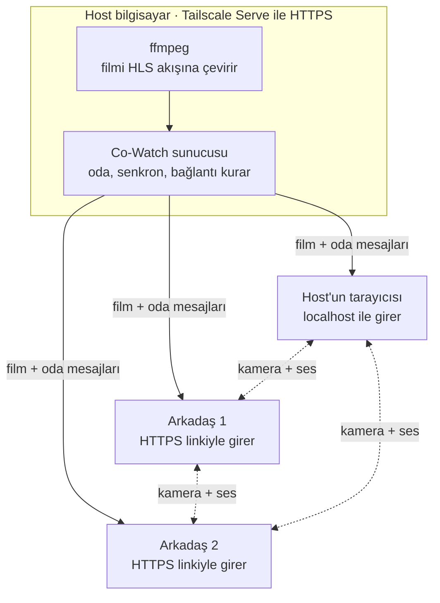

# Kamera ve ses planı

> claude.ai'deki "Co-Watch: Kamera ve Ses Planı" dokümanının 28 Ekim 2026 tarihli kopyası. Yerel geliştirmede bu dosya esas alınır.

Kamera ve mikrofon Meet'teki gibi ayrı ayrı açılıp kapanacak; görüntü ve ses sunucuya uğramadan izleyiciler arasında doğrudan (WebRTC) gidecek, film akışına dokunmayacak. Önce bir engel kalkmalı: tarayıcılar kamera ve mikrofonu sadece HTTPS'te açıyor, arkadaşlar ise şu an düz http adresiyle bağlanıyor. Sondaki dört karar proje sahibinin.

## Mimari



Düz oklar sunucudan geçer: film ve oda mesajları. Kesikli oklar kamera ve sesi taşır ve sunucuya hiç uğramaz; sunucu sadece eşlerin birbirini bulması için kısa mesajları iletir.

## Ön koşul: HTTPS

Arkadaşların kamerası ve mikrofonu ancak uygulama HTTPS'e geçince açılabilir. Tarayıcılar bu izni sadece güvenli sayfalara veriyor: HTTPS ya da `localhost`. Düz `http://100.x.y.z:8000` adresinde `navigator.mediaDevices` hiç yok ([MDN](https://developer.mozilla.org/en-US/docs/Web/API/MediaDevices/getUserMedia)); host `localhost` ile girdiği için onda çalışır, arkadaşlarda çalışmaz.

Önerim Tailscale Serve: tek komutla `https://<bilgisayar-adı>.<tailnet>.ts.net` adresi açılıyor, sertifikayı Tailscale kendisi alıyor ([Tailscale Serve](https://tailscale.com/kb/1312/serve)). Gerekenler:

1. Tailscale yönetim panelinde MagicDNS ve HTTPS Certificates açılır ([Enabling HTTPS](https://tailscale.com/kb/1153/enabling-https/)). Bilgisayarın adı herkese açık sertifika kayıtlarına düşer; adda kişisel bilgi varsa önce değiştirilir.
2. `tailscale serve 8000` çalışır; bunu `run.py` kendisi başlatıp HTTPS linkini yazar.
3. Arkadaş, bilgisayar onunla paylaşıldıktan sonra HTTPS linkine girer; Serve paylaşılan kullanıcılara da açık.

Bir güvenlik düzeltmesi şart. Serve istekleri sunucuya `127.0.0.1`'den geliyormuş gibi iletiyor; bugünkü kod bunu host sayar ve arkadaşa yerel dosya açma yetkisi verirdi. Serve her kullanıcı isteğine `Tailscale-User-Login` başlığını ekliyor, dışarıdan gelen sahte kopyasını siliyor; bu başlığı taşıyan istek host sayılmayacak. Host yine `localhost` linkini kullanır.

Alternatif: sertifikayı `tailscale cert` ile dosya olarak alıp Uvicorn'a vermek. İstemci adresleri olduğu gibi kalır ama sertifika 90 günde bir elle yenilenir. WebSocket'in Serve üzerinden geçtiği ilk adımda doğrulanacak; belgelerde yazmıyor.

## Ses

Mikrofon tek tuşla açılıp kapanacak; açıkken ses herkese doğrudan gidecek, sunucu sadece bağlantıyı kurdurur. Tarayıcının yankı engelleme, gürültü bastırma ve otomatik ses seviyesi ayarları açık olacak.

- **Aç/kapa:** Kapatınca mikrofon gerçekten bırakılır, sekmedeki kırmızı mikrofon işareti söner. Üye listesinde ve kamera kutusunda susturulmuş simgesi görünür.
- **Kim konuşuyor:** Konuşanın kutusu ve imleç topu kendi renginde parlar.
- **Konuşunca film sesi kısılır:** Biri konuşurken film sesi yaklaşık yarıya iner, susunca yavaşça geri gelir. Herkes kendi ekranında açıp kapatır.
- **Kişi başına ses:** Birinin sesi kısık gelirse onun kutusundan yükseltilir.

En büyük risk, hoparlörden çıkan film sesinin mikrofona kaçıp karşıya geri gitmesi. Chrome kendi çaldığı sesi mikrofondan temizleyebiliyor; Ağustos 2026 tarihli bir forum kaydında Chrome'da temizlenen video sesinin Edge'de sızdığı bildirilmiş ([Zoom geliştirici forumu](https://devforum.zoom.us/t/issupportchromewideaec-sniffs-browser-name-version-breaking-echo-cancellation-on-microsoft-edge/145288)). Bu resmi bir garanti değil; ikinci adımda hoparlörle denenecek, o zamana kadar öneri kulaklık ve Chrome.

## Kamera ve ekran düzeni

```
+--------------------------------------------------------+
|                                          +-----------+ |
|                                          | Arkadaş 1 | |  1: konuşanın kenarı kendi renginde yanar
|                                          +-----------+ |
|                  film                    |   (o o)   | |  2: kamerası kapalı olanın yerinde renkli top
|                                          +-----------+ |
|                                          |    Sen    | |  kendi görüntün, ayna gibi çevrilmiş
|                                          +-----------+ |
|                                           [kalem/renk] |  4: çizim araçları kutuların altına iner
|                 ikinci altyazı (EN)                    |
|                  ana altyazı (TR)                      |
+--------------------------------------------------------+
| >  -10 +10   0:42 / 1:58:10   [mik] [kam]    ses   [ ] |  3: yeni tuşlar; kapalı olan kırmızı
+--------------------------------------------------------+
```

Kamera kutuları filmin üstünde durur ve filmi küçültmez; düzeni herkes kendi ekranında ayarlar. Kutular sürüklenip başka köşeye alınabilir, tek tuşla küçülür.

- **Aç/kapa:** Kamera kapanınca cihaz bırakılır, kameranın ışığı söner; kutuda o kişinin renkli topu kalır.
- **Kendi görüntün:** Ayna gibi çevrilmiş küçük kutu, istersen gizlenir.
- **Cihaz seçimi:** Birden fazla kamera ya da mikrofon varsa tuşun yanındaki oktan seçilir.
- **Tam ekran ve telefon:** Kutular tam ekranda da kalır; telefonda küçülür, istenirse tümü gizlenir.
- **Görüntü kalitesi:** Kutular küçük olduğu için 640×360 yeter; yükü aşağıdaki tabloda.

## Bant genişliği

Kamera ve ses filmin yanında küçük kalıyor: 2 kişide kişi başına yaklaşık 0,55 Mbps upload ekliyor. Herkes görüntüsünü diğer herkese ayrı gönderdiği için yük kişi sayısıyla artıyor.

| Kişi sayısı | Kamera + ses, kişi başı upload | Host'un film upload'u (5 Mbps'lik dosya) |
| --- | --- | --- |
| 2 | ~0,55 Mbps | 5 Mbps |
| 3 | ~1,1 Mbps | 10 Mbps |
| 4 | ~1,65 Mbps | 15 Mbps |

Hesap tahmini, ilk adımlarda ölçülecek: kamera 640×360, saniyede 24 kare, en fazla 500 kbps; ses Opus, yaklaşık 40 kbps. 4 kişiyi geçerse görüntüyü sunucudan dağıtan bir yapı (SFU) gerekir, şimdilik gerek yok. Upload sıkışırsa önce kamera kalitesi düşer, film akışı korunur.

## Uygulama adımları

Dört adım var; her biri ayrı bir commit ve host bilgisayarda bir deneme. Görüntü ve ses testleri Chromium'un sahte kamera ve mikrofonuyla (`--use-fake-device-for-media-stream --use-fake-ui-for-media-stream`) iki pencerede otomatik yapılabilir.

1. **HTTPS:** Tailscale Serve, host kontrolünün düzeltilmesi, `run.py`'nin HTTPS linkini yazması. Ölçüt: arkadaş HTTPS linkiyle girer, oda ve film eskisi gibi çalışır, yerel dosya alanı ona görünmez.
2. **Ses:** mikrofon tuşu, eşler arası bağlantı ([perfect negotiation](https://developer.mozilla.org/en-US/docs/Web/API/WebRTC_API/Perfect_negotiation) düzeniyle), konuşan göstergesi, film sesini kısma. Ölçüt: hoparlörle denemede film sesi karşıya gitmez; mikrofon kapanınca sekmedeki kırmızı işaret söner.
3. **Kamera:** kamera tuşu, video üstünde kutular, kamera kapalıyken renkli top, cihaz seçimi. Ölçüt: iki yönde görüntü var, kamera kapanınca ışığı söner, tam ekranda kutular yerinde.
4. **Cila:** Meet'teki gibi giriş ekranında önizleme, kısayollar (mikrofon Ctrl+D, kamera Ctrl+E), bağlantı koparsa kendiliğinden yeniden kurma. Ölçüt: Tailscale üzerinden başından sonuna bir film.

## Riskler

En olası sorun film sesinin mikrofona kaçması; diğerleri bağlantı kurulumuyla ilgili ve her birinin B planı var.

| Risk | Etkisi | B planı |
| --- | --- | --- |
| Film sesi mikrofona kaçar (özellikle Edge'de) | Karşı taraf filmi iki kez, gecikmeli duyar | Kulaklık, Chrome; gerekirse "konuşurken bas" modu |
| Kamerası ve mikrofonu kapalı izleyicide tarayıcı yerel adresleri gizler ([mDNS](https://bloggeek.me/psa-mdns-and-local-ice-candidates-are-coming/)) | O izleyiciyle bağlantı bazen kurulamaz | Karşı tarafın Tailscale adresi üzerinden bağlanır; olmazsa host bilgisayarda bir TURN aktarıcısı |
| Tailscale doğrudan yol bulamaz, trafik aktarıcı sunuculardan (DERP) geçer | Gecikme artar, hız düşer | Kamera kalitesi kendiliğinden düşer, ses öncelikli kalır |
| Serve WebSocket'i taşımaz | Oda bağlantısı kurulamaz | `tailscale cert` ile Uvicorn'un kendi HTTPS'i |
| Upload yetmez | Film takılır | Kamera kalitesi düşer, gerekirse kamera kapanır; film korunur |

## Kararlar

Dört konuda seçim proje sahibinin; önerilen varsayılanlarla hemen başlanabilir.

| Karar | Seçenekler | Önerilen |
| --- | --- | --- |
| Kamera kutularının yeri | Video üstünde köşe · videonun yanında şerit | Video üstünde sağ üst köşe; sürüklenip başka köşeye alınır, tek tuşla küçülür |
| Konuşunca film sesi kısılsın mı | Açık · kapalı · herkes kendi seçsin | Herkes kendi seçsin, başta açık |
| Odaya girerken | Mikrofon ve kamera kapalı başlar · Meet'teki gibi önizlemeli giriş ekranı | Şimdilik kapalı başlasın; önizleme 4. adımda |
| HTTPS yolu | Tailscale Serve · `tailscale cert` ile Uvicorn | Tailscale Serve |

## Kaynaklar

- [Tailscale Serve](https://tailscale.com/kb/1312/serve): HTTPS, kimlik başlıkları, paylaşılan kullanıcılar
- [Tailscale: Enabling HTTPS](https://tailscale.com/kb/1153/enabling-https/): MagicDNS, sertifika kayıtları, 90 günlük süre
- [MDN: getUserMedia()](https://developer.mozilla.org/en-US/docs/Web/API/MediaDevices/getUserMedia): güvenli sayfa şartı
- [MDN: Perfect negotiation](https://developer.mozilla.org/en-US/docs/Web/API/WebRTC_API/Perfect_negotiation): eşler arası bağlantının kurulma düzeni
- [Zoom geliştirici forumu, Ağustos 2026](https://devforum.zoom.us/t/issupportchromewideaec-sniffs-browser-name-version-breaking-echo-cancellation-on-microsoft-edge/145288): Chrome'un kendi sesini mikrofondan temizlemesi
- [BlogGeek.me: mDNS ve .local adayları](https://bloggeek.me/psa-mdns-and-local-ice-candidates-are-coming/): tarayıcının yerel adresleri gizlemesi
