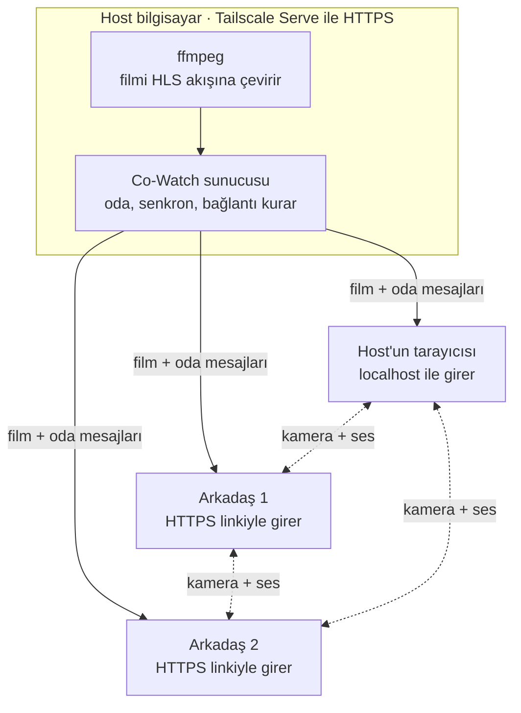

# Kamera ve ses planı

> claude.ai'deki "Co-Watch: Kamera ve Ses Planı" dokümanının 28 Ekim 2026 tarihli kopyası, aynı gün kodla karşılaştırılıp düzeltildi. Yerel geliştirmede bu dosya esas alınır; claude.ai'deki sürüm artık bunun gerisinde.

Kamera ve mikrofon Meet'teki gibi ayrı ayrı açılıp kapanacak; görüntü ve ses sunucuya uğramadan izleyiciler arasında doğrudan (WebRTC) gidecek, film akışına dokunmayacak. Önce bir engel kalkmalı: tarayıcılar kamera ve mikrofonu sadece HTTPS'te açıyor, arkadaşlar ise şu an düz http adresiyle bağlanıyor. Sondaki beş karar proje sahibinin.

**Bu düzeltmede değişenler:**

- Arkadaşların tailnet'e nasıl katılacağı yeni bir karar oldu. Makine paylaşımıyla gelen iki arkadaş Tailscale üzerinden birbirine ulaşamıyor; 3 kişide kamera ve ses bu yüzden kurulamazdı.
- Host kontrolü sadece `Tailscale-User-Login` başlığına bakmıyor; adres, `Host` ve `X-Forwarded-For` de denetleniyor. Serve açıkken sunucu sadece `127.0.0.1`'i dinliyor.
- Eşler arası bağlantının ayrıntıları yazıldı: sinyal mesajları, kimin teklif ettiği, aç/kapa'da yeniden pazarlık yapılmaması, WebSocket yeniden bağlanınca kimliğin değişmesi.
- Konuşan tespiti, film sesini kısma ve kişi başına ses Chrome'un bilinen tuzaklarına göre yeniden tarif edildi.
- Mevcut kısayollar ve tıklama davranışıyla çakışmalar, hata mesajları, testler ve belge güncellemeleri adımlara eklendi.
- `tests/e2e/two_viewers.py` depoda yok, Playwright kurulu değil; tarayıcı testi 1. adımda yeniden yazılacak.

## Mimari



Düz oklar sunucudan geçer: film ve oda mesajları. Kesikli oklar kamera ve sesi taşır ve sunucuya hiç uğramaz; sunucu sadece eşlerin birbirini bulması için kısa mesajları iletir. Kesikli okların Tailscale üzerinden gidebilmesi için her izleyicinin diğerine ulaşabilmesi gerekir; aşağıdaki "Arkadaşlar tailnet'e nasıl katılır" bölümü bunu anlatıyor.

## Ön koşul: HTTPS

Arkadaşların kamerası ve mikrofonu ancak uygulama HTTPS'e geçince açılabilir. Tarayıcılar bu izni sadece güvenli sayfalara veriyor: HTTPS ya da `localhost`. Düz `http://100.x.y.z:8000` adresinde `navigator.mediaDevices` hiç yok ([MDN](https://developer.mozilla.org/en-US/docs/Web/API/MediaDevices/getUserMedia)); host `localhost` ile girdiği için onda çalışır, arkadaşlarda çalışmaz.

Önerim Tailscale Serve: tek komutla `https://<bilgisayar-adı>.<tailnet>.ts.net` adresi açılıyor, sertifikayı Tailscale kendisi alıyor ([Tailscale Serve](https://tailscale.com/kb/1312/serve)). Gerekenler:

1. Tailscale kurulur (host bilgisayarda henüz yok). Yönetim panelinde MagicDNS ve HTTPS Certificates açılır ([Enabling HTTPS](https://tailscale.com/kb/1153/enabling-https/)); eksik bir şey varsa `tailscale serve` ilk çalıştığında onay sayfasının linkini kendisi yazar. Bilgisayarın adı herkese açık sertifika kayıtlarına düşer; adda kişisel bilgi varsa önce değiştirilir.
2. `run.py`, `tailscale serve http://127.0.0.1:8000` komutunu alt süreç olarak başlatır, HTTPS linkini `tailscale status --json` çıktısındaki `Self.DNSName`'den kurar ve yazar. Serve ön planda çalışır, `run.py` kapanınca o da kapanır. `--bg` kullanılmaz: o mod yeniden başlatmalardan sonra da açık kalır ve kapalı bir porta yönlendirmeye devam eder ([CLI](https://tailscale.com/kb/1242/tailscale-serve)).
3. Arkadaş HTTPS linkine girer. Hangi yolla tailnet'e katılacağı aşağıda.

**Sunucu sadece `127.0.0.1`'i dinler.** Serve açıkken `HOST` varsayılanı `127.0.0.1` olur; düz `http://100.x:8000` ve ev ağı linkleri çalışmaz ve `run.py` bunları yazmaz. Yoksa bir arkadaş eski linkle girip kamerasını açamaz ve neden açamadığını anlamaz. Tailscale bulunamazsa ya da `.env`'de `TAILSCALE_SERVE=0` verilirse bugünkü davranış (`0.0.0.0`, http linkleri) sürer.

**Host kontrolü düzeltilir.** Serve istekleri sunucuya `127.0.0.1`'den iletiyor; bugünkü `is_local` bunu host sayar ve arkadaşa yerel dosya açma yetkisi verirdi. Serve her kullanıcı isteğine `Tailscale-User-Login` başlığını ekliyor, dışarıdan gelen sahte kopyasını siliyor; paylaşılan kullanıcılarda da ekliyor, sadece etiketli (tagged) cihazlarda eklemiyor. Tek bir başlığa güvenmemek için bir istek ancak hepsi tutarsa host sayılır:

- bağlantı loopback adresinden (`127.0.0.1`, `::1`),
- `Host` başlığı `localhost`, `127.0.0.1` ya da `[::1]` (Serve'den gelende `*.ts.net` olur),
- `Tailscale-User-Login`, `X-Forwarded-For` ve `Forwarded` başlıklarının hiçbiri yok.

Host yine `http://localhost:8000` linkini kullanır. `/api/media/close` ve torrent ekleme bugün olduğu gibi herkese açık kalır; sadece yerel dosya açma host'a özel.

Alternatif: sertifikayı `tailscale cert` ile dosya olarak alıp Uvicorn'a vermek. İstemci adresleri olduğu gibi kalır ama sertifika 90 günde bir elle yenilenir. Serve'ün WebSocket'i taşıyıp taşımadığı belgelerde yazmıyor; Serve bir Go ters vekili olduğu için büyük olasılıkla taşıyor, 1. adımın ilk işi bunu denemek.

## Arkadaşlar tailnet'e nasıl katılır

Tailscale'de iki yol var, kamera ve ses için farkları büyük:

| Yol | Film ve oda | Arkadaş ↔ host kamera/ses | Arkadaş ↔ arkadaş kamera/ses |
| --- | --- | --- | --- |
| Tailnet'e kullanıcı olarak davet | Çalışır | Çalışır, iki yön de açık | Çalışır |
| Sadece host makinesini paylaşmak | Çalışır | Arkadaşın başlattığı yönde çalışır; host'un tarayıcısı izin vermemişse kurulamayabilir (Riskler'de mDNS) | **Kurulamaz:** iki arkadaşın cihazı birbirini görmüyor |

Paylaşım tek yönlü: arkadaş host makinesine ulaşır, host ve diğer arkadaşlar onun cihazına ulaşamaz. Öneri davet: Tailscale'in kişisel planı 6 kullanıcıya kadar ücretsiz ve varsayılan erişim kuralı herkesi birbirine açıyor. Paylaşım seçilirse 3 kişilik odada arkadaşlar arasındaki bağlantı için host bilgisayarda bir TURN aktarıcısı (coturn, sadece Tailscale adresini dinler) gerekir.

## Ses

Mikrofon tek tuşla açılıp kapanacak; açıkken ses herkese doğrudan gidecek, sunucu sadece bağlantıyı kurdurur. Tarayıcının yankı engelleme, gürültü bastırma ve otomatik ses seviyesi ayarları açık olacak (`echoCancellation`, `noiseSuppression`, `autoGainControl`).

- **Aç/kapa:** Kapatınca mikrofon gerçekten bırakılır (`track.stop()`), sekmedeki kırmızı mikrofon işareti söner. Üye listesinde ve kamera kutusunda susturulmuş simgesi görünür. Bu durum WebSocket'le yayınlanır; karşı tarafın gelen ses izinin sessizleşmesini beklemek güvenilir değil.
- **Kim konuşuyor:** Konuşanın kutusu, üye çipi ve imleç topu kendi renginde parlar. Karşı tarafların ses seviyesi `RTCRtpReceiver.getSynchronizationSources()`'un `audioLevel` değerinden 100 ms'de bir okunur; kendi mikrofonun için yerel izde bir `AnalyserNode` kullanılır. Uzak sesi WebAudio'ya bağlamaktan kaçınılır: Chrome'da uzak WebRTC akışı bir medya öğesine de bağlanmazsa WebAudio sessizlik verir.
- **Konuşunca film sesi kısılır:** Biri konuşurken (seviye 150 ms boyunca eşiğin üstünde) film sesi 0,3 sn'de yaklaşık yarıya iner, 0,8 sn sessizlikten sonra 1 sn'de geri gelir. Kısma ses kaydırıcısını oynatmaz: gerçek ses = kaydırıcı × kısma çarpanı, kaydırıcının değeri `prefs.volume`'da olduğu gibi saklanır. Herkes kendi ekranında açıp kapatır.
- **Kişi başına ses:** Her kişinin sesi kendi gizli `<audio>` öğesinden çalar, kutusundaki kaydırıcı onun `volume`'unu %0–100 arasında ayarlar. Gönderen tarafta otomatik ses seviyesi açık olduğu için çoğu zaman yeter. %100'ün üstüne yükseltmek (`GainNode`) gerekirse 4. adımda, yankı denemesinden sonra eklenir.

En büyük risk, hoparlörden çıkan film sesinin mikrofona kaçıp karşıya geri gitmesi. Chrome kendi çaldığı sesi mikrofondan temizleyebiliyor; Ağustos 2026 tarihli bir forum kaydında Chrome'da temizlenen video sesinin Edge'de sızdığı bildirilmiş ([Zoom geliştirici forumu](https://devforum.zoom.us/t/issupportchromewideaec-sniffs-browser-name-version-breaking-echo-cancellation-on-microsoft-edge/145288)). Bu resmi bir garanti değil; ikinci adımda hoparlörle denenecek, o zamana kadar öneri kulaklık ve Chrome.

## Kamera ve ekran düzeni

```
+--------------------------------------------------------+
|                                          +-----------+ |
|                                          | Arkadaş 1 | |  1: konuşanın kenarı kendi renginde yanar
|                                          +-----------+ |
|                  film                    |   (o o)   | |  2: kamerası kapalı olanın yerinde renkli top
|                                          +-----------+ |
|                                          |    Sen    | |  kendi görüntün, ayna gibi çevrilmiş
|                                          +-----------+ |
|                                           [kalem/renk] |  4: çizim araçları kutuların altına iner
|                 ikinci altyazı (EN)                    |
|                  ana altyazı (TR)                      |
+--------------------------------------------------------+
| >  -10 +10   0:42 / 1:58:10   [mik] [kam]    ses   [ ] |  3: yeni tuşlar; kapalı olan kırmızı
+--------------------------------------------------------+
```

Kamera kutuları filmin üstünde durur ve filmi küçültmez; düzeni herkes kendi ekranında ayarlar. Kutular sürüklenip başka köşeye alınabilir, tek tuşla küçülür.

- **Aç/kapa:** Kamera kapanınca cihaz bırakılır, kameranın ışığı söner; kutuda o kişinin renkli topu kalır.
- **Kendi görüntün:** Ayna gibi çevrilmiş küçük kutu, istersen gizlenir.
- **Cihaz seçimi:** Birden fazla kamera ya da mikrofon varsa tuşun yanındaki oktan seçilir. Cihaz adları ancak izin verildikten sonra görünür; seçim `prefs`'e kaydedilir, cihaz takılıp çıkarılınca (`devicechange`) liste yenilenir, kayıtlı cihaz yoksa varsayılana dönülür.
- **Tam ekran ve telefon:** Tam ekrana giren öğe `#stage` olduğu için kutular onun içinde durur ve tam ekranda kalır. iPhone'da tam ekran sadece video öğesine verildiği için orada kutular tam ekranda görünmez. Telefonda kutular küçülür, istenirse tümü gizlenir.
- **Görüntü kalitesi:** Kutular küçük olduğu için 640×360 yeter; yükü aşağıdaki tabloda.

Mevcut arayüzle uyum:

- Kutular `#stage` içinde, çizim tuvalinin ve imleç toplarının üstünde durur. `isUi` kutuları da kapsar: kutuya tıklamak dürtme sayılmaz, çift tıklama tam ekran yapmaz.
- Fare durunca kontroller gizlenir (`idle`), kutular gizlenmez.
- Sağdaki çizim araç çubuğu kutuların altına iner; kutular küçültülünce yukarı çıkar.

## Eşler arası bağlantı

Her izleyici çifti arasında bir `RTCPeerConnection` kurulur (mesh). Sunucu SDP'yi okumaz, sadece iletir.

**Sinyal mesajları (WebSocket):**

| Mesaj | Yön | Sunucunun yaptığı |
| --- | --- | --- |
| `{type: "rtc", to, data}` | istemci → sunucu | `to` odada ve gönderenden farklıysa, mesaj 64 KB'ı aşmıyorsa `{type: "rtc", from, data}` olarak sadece ona iletir. Sıra korunur: aynı alıcıya giden mesajlar gönderildiği sırayla varır. |
| `{type: "av", mic, cam}` | istemci → sunucu | `Client.mic` ve `Client.cam`'i günceller, herkese `members` yayınlar |
| `members` | sunucu → herkes | Her üyede yeni `mic` ve `cam` alanları |

`data` ya `{description}` ya da `{candidate}`; perfect negotiation düzeni ([MDN](https://developer.mozilla.org/en-US/docs/Web/API/WebRTC_API/Perfect_negotiation)). `hello` de `mic` ve `cam` taşır, böylece yeniden bağlanan biri durumunu hemen bildirir.

**Bağlantının kuruluşu:**

- Bir üye `members` listesinde ad almış göründüğünde (yani `hello` göndermişse) onunla bağlantı açılır, listeden çıkınca kapatılır.
- Kibar (polite) taraf: kimliği alfabetik olarak büyük olan. Teklifi kimliği küçük olan başlatır ve iki transceiver ekler (ses, görüntü, `sendrecv`). Karşı taraf kendi transceiver'ını eklemez; teklifi aldıktan sonra gelen transceiver'ları `sendrecv` yapar ve öyle cevaplar. İki taraf da eklerse dört transceiver olur ve görüntü yanlış yere bağlanır.
- **Aç/kapa yeniden pazarlık gerektirmez.** Mikrofon açılınca `getUserMedia` ile alınan iz her bağlantıdaki ses göndericisine `sender.replaceTrack(track)` ile verilir; kapanınca `replaceTrack(null)` ve `track.stop()`. Kamera da aynı. Sonradan katılan biriyle kurulan bağlantıya o anki izler hemen verilir.
- **ICE sunucusu yok** (`iceServers: []`): adaylar sadece bilgisayarın kendi adresleri, aralarında Tailscale adresi (100.x) var. Görüntü ve ses böylece Tailscale'in şifreli tünelinden gider, üçüncü bir sunucuya adres sızmaz. Gerekirse `.env`'den STUN ya da TURN adresi verilebilir.
- **Bant sınırı:** görüntü göndericisinde `maxBitrate` 500 kbps, `maxFramerate` 24; sesin önceliği yüksek, görüntününki düşük (`priority`, `networkPriority`).
- **Yeniden bağlanma:** WebSocket koparsa sunucu yeni bir `clientId` verir. İstemci yeniden bağlanınca bütün eş bağlantılarını kapatır ve `members` geldiğinde yeniden kurar; açık mikrofon ve kamera izleri bırakılmaz, yeni bağlantılara verilir. Bağlantı `failed` olursa önce `restartIce()` denenir.

**Hatalar** (üç dilde uyarı): izin reddedildi (`NotAllowedError`), cihaz yok (`NotFoundError`), cihazı başka bir uygulama kullanıyor (`NotReadableError`; Windows'ta Teams ya da Zoom açıkken sık olur), kayıtlı cihaz çıkarılmış (`OverconstrainedError`, varsayılan cihazla tekrar denenir).

## Bant genişliği

Kamera ve ses filmin yanında küçük kalıyor: 2 kişide kişi başına yaklaşık 0,55 Mbps upload ekliyor. Herkes görüntüsünü diğer herkese ayrı gönderdiği için yük kişi sayısıyla artıyor.

| Kişi sayısı | Kamera + ses, kişi başı upload | Host'un film upload'u (5 Mbps'lik dosya) | Host'un toplam upload'u |
| --- | --- | --- | --- |
| 2 | ~0,55 Mbps | 5 Mbps | ~5,6 Mbps |
| 3 | ~1,1 Mbps | 10 Mbps | ~11,1 Mbps |
| 4 | ~1,65 Mbps | 15 Mbps | ~16,7 Mbps |

Hesap tahmini, ilk adımlarda ölçülecek: kamera 640×360, saniyede 24 kare, en fazla 500 kbps; ses Opus, yaklaşık 40 kbps. 4 kişiyi geçerse görüntüyü sunucudan dağıtan bir yapı (SFU) gerekir, şimdilik gerek yok. Upload sıkışırsa önce kamera kalitesi düşer (`maxBitrate` ve düşük öncelik), film akışı korunur.

## Uygulama adımları

Dört adım var; her biri ayrı bir commit ve host bilgisayarda bir deneme. Her adımda yeni arayüz metinleri `web/i18n.js`'in `tr`, `en` ve `ru` bölümlerine birlikte eklenir; kurulumu değiştiren adımlar iki README'yi ve `CLAUDE.md`'yi de günceller.

1. **HTTPS ve tarayıcı testi:**
   - Tailscale kurulumu, MagicDNS ve HTTPS sertifikalarının açılması (elle, proje sahibi). İlk iş Serve üzerinden WebSocket'in geçtiğini denemek; geçmezse `tailscale cert` yoluna dönülür.
   - `run.py`: Serve'ü alt süreç olarak başlatır ve kapatır, HTTPS linkini yazar, Serve açıkken `HOST=127.0.0.1` ve http linkleri yazılmaz. `.env.example`'a `TAILSCALE_SERVE`.
   - `is_local` yukarıdaki üç koşulla; pytest: Serve başlıklarıyla gelen loopback isteği, `Host: x.ts.net` ile gelen istek ve düz `localhost` isteği.
   - Tarayıcı testi yeniden yazılır (`tests/e2e/two_viewers.py`; ilk oturumdaki depoya girmemiş). Playwright `requirements-dev.txt`'ye; `python -m playwright install chromium`. Normal `pytest` çalıştırmasına girmez, ayrı komutla koşulur; komut `CLAUDE.md`'ye yazılır.
   - Ölçüt: arkadaş HTTPS linkiyle girer, oda ve film eskisi gibi çalışır, yerel dosya alanı ona görünmez, düz http linki açılmaz.
2. **Ses:**
   - Sunucu: `rtc` iletimi, `av` mesajı, `members`'ta `mic` ve `cam`. pytest: mesaj sadece hedefe gider, `from` sunucu tarafından yazılır, odada olmayan hedef ve büyük mesaj düşer, sıra korunur.
   - İstemci: mikrofon tuşu, eş bağlantıları, konuşan göstergesi, film sesini kısma, kişi başına ses.
   - Kısayol: `Ctrl+D` (Mac'te `Cmd+D`) mikrofon. Bugünkü klavye işleyicisi `d`'de kalemi açıyor; değiştirici tuşa basılıysa kalem tepki vermemeli. `m` film sesini kısmaya devam eder.
   - Tarayıcı testi: iki Chromium penceresi, sahte cihazlar (`--use-fake-device-for-media-stream --use-fake-ui-for-media-stream`); sahte mikrofonun bip sesiyle karşıda konuşan göstergesi ve film sesinin kısıldığı denenir.
   - Ölçüt: hoparlörle denemede film sesi karşıya gitmez; mikrofon kapanınca sekmedeki kırmızı işaret söner; WebSocket koparıp yeniden bağlanınca ses geri gelir.
3. **Kamera:**
   - Kamera tuşu (`Ctrl+E`), video üstünde kutular, kamera kapalıyken renkli top, cihaz seçimi, bant sınırı.
   - Ölçüt: iki yönde görüntü var, kamera kapanınca ışığı söner, tam ekranda kutular yerinde, kutuya tıklamak kimseyi dürtmez.
4. **Cila:**
   - Meet'teki gibi giriş ekranında önizleme, kutuların sürüklenmesi ve küçültülmesi, gerekirse %100'ün üstünde kişi başına ses.
   - Ölçüt: Tailscale üzerinden, arkadaşlarla gerçek ağlarda başından sonuna bir film.

## Riskler

En olası sorun film sesinin mikrofona kaçması; diğerleri bağlantı kurulumuyla ilgili ve her birinin B planı var.

| Risk | Etkisi | B planı |
| --- | --- | --- |
| Film sesi mikrofona kaçar (özellikle Edge'de) | Karşı taraf filmi iki kez, gecikmeli duyar | Kulaklık, Chrome; gerekirse "konuşurken bas" modu |
| Arkadaşlar makine paylaşımıyla bağlanır | İki arkadaş arasında kamera ve ses kurulamaz | Tailnet'e davet; olmazsa host bilgisayarda TURN aktarıcısı |
| Kamerasına ve mikrofonuna izin vermemiş tarayıcı yerel adreslerini gizler ([mDNS](https://bloggeek.me/psa-mdns-and-local-ice-candidates-are-coming/)) | Karşı taraf da ona ulaşamıyorsa bağlantı kurulamaz. Davetle katılımda karşı taraf ona ulaşabildiği için sorun beklenmez; paylaşımda host izin vermemişse arkadaşın kamerası host'a gelmeyebilir | Davetle katılım; host'un mikrofon iznini bir kez vermesi; TURN aktarıcısı |
| Tailscale doğrudan yol bulamaz, trafik aktarıcı sunuculardan (DERP) geçer | Gecikme artar, hız düşer | Kamera kalitesi kendiliğinden düşer, ses öncelikli kalır |
| Serve WebSocket'i taşımaz | Oda bağlantısı kurulamaz | `tailscale cert` ile Uvicorn'un kendi HTTPS'i |
| Upload yetmez | Film takılır | Kamera kalitesi düşer, gerekirse kamera kapanır; film korunur |
| Telefonda mikrofon açılınca işletim sistemi ses düzenini değiştirir (özellikle iOS) | Film sesi kısılabilir ya da ahizeden çıkabilir | Telefonda kulaklık önerisi; 4. adımda denenir |

## Kararlar

Beş konuda seçim proje sahibinin; önerilen varsayılanlarla hemen başlanabilir.

| Karar | Seçenekler | Önerilen |
| --- | --- | --- |
| Kamera kutularının yeri | Video üstünde köşe · videonun yanında şerit | Video üstünde sağ üst köşe; sürüklenip başka köşeye alınır, tek tuşla küçülür |
| Konuşunca film sesi kısılsın mı | Açık · kapalı · herkes kendi seçsin | Herkes kendi seçsin, başta açık |
| Odaya girerken | Mikrofon ve kamera kapalı başlar · Meet'teki gibi önizlemeli giriş ekranı | Şimdilik kapalı başlasın; önizleme 4. adımda |
| HTTPS yolu | Tailscale Serve · `tailscale cert` ile Uvicorn | Tailscale Serve |
| Arkadaşlar tailnet'e nasıl katılır | Kullanıcı olarak davet · host makinesini paylaşmak | Davet: 3 kişide arkadaşlar birbirini görebilsin diye |

## Kaynaklar

- [Tailscale Serve](https://tailscale.com/kb/1312/serve): HTTPS, kimlik başlıkları (paylaşılan kullanıcılarda da var, etiketli cihazlarda yok), sahte başlıkların silinmesi
- [Tailscale serve komutu](https://tailscale.com/kb/1242/tailscale-serve): ön plan ve `--bg`, `reset`, `status`
- [Tailscale: Enabling HTTPS](https://tailscale.com/kb/1153/enabling-https/): MagicDNS, sertifika kayıtları, 90 günlük süre
- [MDN: getUserMedia()](https://developer.mozilla.org/en-US/docs/Web/API/MediaDevices/getUserMedia): güvenli sayfa şartı, hata türleri
- [MDN: Perfect negotiation](https://developer.mozilla.org/en-US/docs/Web/API/WebRTC_API/Perfect_negotiation): eşler arası bağlantının kurulma düzeni
- [MDN: RTCRtpReceiver.getSynchronizationSources()](https://developer.mozilla.org/en-US/docs/Web/API/RTCRtpReceiver/getSynchronizationSources): gelen sesin seviyesi
- [Zoom geliştirici forumu, Ağustos 2026](https://devforum.zoom.us/t/issupportchromewideaec-sniffs-browser-name-version-breaking-echo-cancellation-on-microsoft-edge/145288): Chrome'un kendi sesini mikrofondan temizlemesi
- [BlogGeek.me: mDNS ve .local adayları](https://bloggeek.me/psa-mdns-and-local-ice-candidates-are-coming/): tarayıcının yerel adresleri gizlemesi
